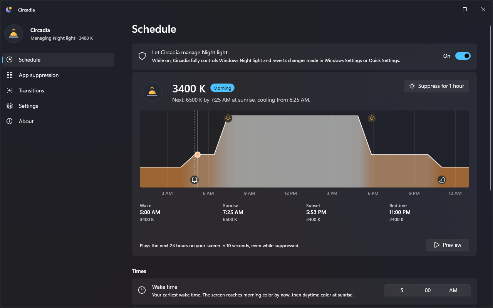

<h1>Circadia </h1>

Circadia is a powerful manager for [Windows Night light](https://support.microsoft.com/en-us/windows/hardware/display-graphics/change-display-brightness-and-color-in-windows#bkmk_night_light). It adjusts your display’s color temperature through Windows’ native functionality, without directly writing GPU gamma ramps or modifying display calibration profiles. Set your preferred color temperatures, choose how gradually they change, and build a schedule around your waking and sleeping hours (with support for additional sunrise and sunset timings). Apps can be added to a suppression list to automatically pause Night light when focused.

Circadia is a **Windows 11 x64 application in development**. Unsigned preview installers are built on every push to `main`, alongside automated checks.

  

## Features

- **Daily temperature schedule**
  - Set Wake and Bedtime schedules with different color temperature levels that support gradual transitions. The schedule supports one daily waking period and one overnight sleep period, including bedtimes after midnight.
- **Optional sunrise and sunset timing**
  - Follow solar events using explicit latitude and longitude coordinates or a location supplied by the Windows location service. Timings are calculated locally, and invalid events are skipped to keep the schedule running.
- **Automatic and manual Night light suppression**
  - Suppress Night light whenever a chosen app has focus, in any window mode. Rules support executable filenames or full paths, optional window-title conditions, and exclusions for apps or windows that should keep the normal schedule.
  - Start or stop a separate one-hour suppression from Settings or the tray, which also offers toggles for recently focused apps. Automatic fullscreen detection is not included.
- **Schedule graph and display preview**
  - See the daily temperature curve, event times, current target, and next change. Preview plays the coming day on your display in seconds, temporarily taking precedence over suppression and disabling settings edits.
- **Automatic saving and Windows preferences**
  - Valid settings edits apply and save automatically. The interface follows Windows themes and regional time and number formats; English is currently the only shipped language.
- **Tray controls and optional startup**
  - Keep Circadia running when Settings closes, reopen it from the tray or by launching the app again, and optionally start it at sign-in. Quit ends control and requests Night light off.

## Comparison with similar tools

Circadia combines native Windows 11 controls with scheduling and app rules for Windows Night light. Its interface follows your light, dark, or contrast theme.

| Feature | Circadia | Windows Night light | f.lux |
| :-- | :---: | :---: | :---: |
| Settings interface | Native Windows 11 controls | Windows Settings | Custom f.lux interface |
| Uses native Windows Night light | ✓ | ✓ | ✗ |
| Sunrise and sunset scheduling | ✓ | ✓ | ✓ |
| Separate daytime, evening, and bedtime temperatures | ✓ | ✗ | ✓ |
| Pause for apps in a user-defined suppression list | ✓ | ✗ | ✓ |
| Pause for all fullscreen apps | ✗ | ✗ | ✓ |
| Included with Windows | ✗ | ✓ | ✗ |

**Calibration profiles:** Circadia does not directly write GPU gamma ramps or modify `.icc`/`.icm` profiles; it delegates color changes to Windows Night light. Whereas [f.lux is known to conflict](https://justgetflux.com/faq.html?q=vcgt) with some custom display calibration settings and display profile loaders.

Circadia lets you set Wake and Bedtime independently and combine them with optional sunrise and sunset times. Automatic suppression follows your app rules in any window mode.

Sources: [Windows Night light settings](https://support.microsoft.com/en-us/windows/hardware/display-graphics/change-display-brightness-and-color-in-windows#bkmk_night_light), [f.lux for Windows](https://justgetflux.com/news/pages/v4/welcome/), [f.lux release notes](https://justgetflux.com/news/pages/v4/readme/), and [f.lux FAQ](https://justgetflux.com/faq.html).

## Getting started

Requires Windows 11 x64 with working native Night light. See [tested compatibility](docs/research/windows-compatibility.md).

1. Sign in to GitHub and open the [Preview runs](https://github.com/kvnxiao/circadia/actions/workflows/preview.yml?query=event%3Apush+branch%3Amain).
2. Select the latest successful run, then download `Circadia-windows-x64-unsigned-<commit>` under **Artifacts**.
3. Extract the ZIP. Quit Circadia from its tray menu if it is running. Run the extracted `*-setup.exe`.
4. Finish installation and open **Circadia** from the Start menu.

Preview builds are unsigned, so Windows may show a SmartScreen warning. See the [user guide](docs/user-guide.md#installation-and-updates) for installation help, updates, and schedule setup.

## Help and development

- [User guide](docs/user-guide.md): settings, app rules, location, configuration recovery, and logs.
- [Development guide](DEVELOPMENT.md): source builds, checks, dependency updates, and implementation boundaries.
- [Tools and experiments](tools/README.md): application checks and dependency experiments, with their prerequisites and system effects.
- [Specification](docs/specs/SPEC.md), [visual design](docs/design/README.md), and [research](docs/research/README.md): intended behavior, interface design, and supporting evidence.

[Report a problem](https://github.com/kvnxiao/circadia/issues/new?template=bug_report.md) with the relevant log from **Settings → Logs → Open folder**. Logs can include coordinates, executable names, paths, and window titles; remove personal information before sharing them. Circadia does not upload logs automatically.

Circadia is licensed under the [MIT License](LICENSE).
