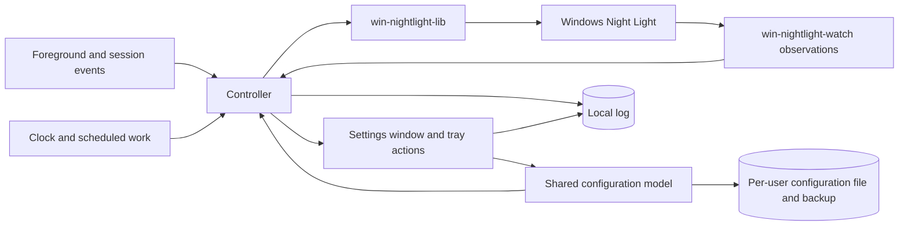

# Circadia

## Purpose and scope

Circadia is a Windows 11 tray application for people who want native Night Light to follow their waking and sleeping hours. Its minimum viable product (MVP) supports one daily activity period and one overnight sleep period, including a bedtime after midnight.

The requirement summaries below are navigation to the authoritative blocks in this spec and its areas; they do not add separate obligations.

## Functional requirements

| Capability | Authoritative requirements |
| :-- | :-- |
| Generate transitions between three ordered temperatures from Wake, Bedtime, and optional solar events. | [Schedule settings, solar selection, and curve evaluation](schedule.md) |
| Temporarily request 6500 K for listed foreground applications or for one hour manually. | [Automatic and manual suppression](suppression.md) |
| Start Night Light management with consent, recover from failures, and end management explicitly. | [Control and lifecycle](control.md), [native access](native-access.md) |
| Apply and save valid edits, recover configuration, preview the schedule, and optionally start at sign-in. | [Configuration, Preview, and launch](application.md) |
| Show settings and tray controls with localizable text and regional times and numbers. | [Settings and tray](interface.md), [localization](localization.md) |
| Record local diagnostics and report crashes when settings opens. | [Log and crash records](diagnostics.md) |

## Nonfunctional requirements

| Guarantee | Authoritative requirements |
| :-- | :-- |
| Keep background work event-driven and settings responsive. | [Idle work](#req-event-driven-idle--perform-background-work-only-when-needed), [graph latency](interface.md#req-display-generated-curve--display-the-schedule-without-point-editing), [output timing](control.md#req-temperature-cadence--request-only-due-temperature-changes) |
| Measure resource use in the single application process. | [Resource measurements](application.md#req-lean-background--measure-the-single-processs-resource-use) |
| Use native Night Light, limited process access, and standard user rights. | [Invariants](#invariants), [security](#security) |
| Preserve native keyboard and accessibility behavior, and fit supported desktop sizes and translated text. | [Settings appearance and layout](interface.md), [translation layout](localization.md#req-translation-layout--fit-translated-text) |

## Non-goals

- Automatic fullscreen suppression in the MVP; see Future work.
- Arbitrary curve-point editing, user-defined offsets, extra fixed-clock targets, or weekday-specific schedules.
- Night-shift scheduling, multiple daily sleep periods, city/address search, or continuous location tracking.
- Per-monitor temperature control, per-app suppression temperatures, or changes to calibration profiles.
- Using the Windows Night Light schedule to drive Circadia's curve.
- A service, elevated helper, watchdog, crash-reporting helper, or separate settings process.
- A temperature-write throughput benchmark, automatic output-rate calibration, or monitor refresh-rate queries.
- Watching the configuration file for changes made outside Circadia while it runs.
- Right-to-left interface languages in the first release; see Future work.
- Uploading logs or crash data automatically.

## Constraints and assumptions

- Use Rust and one `windows-reactor` application process per user session. The MVP targets Windows 11 x64, build 22000 or later, and distributes the required native Windows App SDK runtime alongside the executable.
- Read and write Night Light through `win-nightlight-lib`; observe its decoded settings and state records through `win-nightlight-watch`.
- Request the Windows Night Light schedule off during control. Errors, turning management off, and exit do not restore or enable that schedule.
- Write temperatures only within the library's supported 1200 K to 6500 K range.
- Prefer direct code and existing library capabilities. Introduce additional components or general abstractions only for a demonstrated requirement or measured limitation.
- Executable size is not a resource target; memory use and CPU time while running are.

**Dependencies:** Circadia uses `win-nightlight-lib` and `win-nightlight-watch` 0.5.0, plus `windows-reactor`, `windows-window`, and `windows-reactor-setup` from the `windows-rs` repository. While Reactor is in preview, these three follow the repository's `master` branch through one reference commit that the application manifest records for all three. Circadia adopts a new commit only after the application's automated checks and the Windows Reactor UI probe pass on it. Supporting evidence links the capability assessments, API contracts, and deployment research.

Circadia does not write GPU gamma ramps or monitor calibration profiles. Successful library operations and decoded registry readback verify native requests. Preview lets the user assess visible output at the configured rate. Registry success alone does not verify smoothness or displayed color. Instrumented optical measurements, calibration preservation by Windows, and optical equivalence between 6500 K and Night Light off are outside the acceptance criteria.

## Background and terms

Night Light stores its schedule, temperature, and native preview flag in a settings record, and its on/off state in a separate state record. Each record is an encoded registry value. Updating one does not atomically update the other. Circadia requests their desired values and observes subsequent changes; it cannot prevent another Windows component from writing them.

Each record has a whole-second timestamp. The library stamps each write at least 2 s after the stored timestamp and after the same handle's earlier writes, so frequent writes move the timestamp ahead of real time. That difference is the timestamp lead; without writes, real time reduces it by 1 s per second. Windows behaves as if it ignores temperature changes stamped at or below the highest timestamp it has applied, so Circadia never moves a timestamp backward.

The suppression list stores entries explicitly added by the user, each an executable file name with optional installation-path and window-title restrictions. Filename-only rules cover every installation with that name; a path restriction limits a rule to one executable location. A separate exclusion list overrides suppression for the windows it matches. Matching depends on current foreground identity and any title condition, not window geometry, fullscreen mode, monitor arrangement, or display scaling.

| Term | Meaning |
| :-- | :-- |
| Controller | The component that evaluates the curve and focus, serializes Night Light operations, and tracks errors. |
| Settings window | The on-demand editor within the same process as the controller and tray icon. |
| Management | The saved setting under which Circadia controls Night Light. |
| Temperature level | Daytime, Morning/Evening, or Sleep, ordered from highest to lowest kelvin. Morning and evening share one value. |
| Schedule target | A Wake, Bedtime, Sunrise, or Sunset occurrence selected for the curve, with the temperature reached at that instant. |
| Scheduled transition | The linear temperature change before a target, using the shared maximum duration or a shorter available interval. |
| Scheduled temperature | The value obtained by evaluating the generated curve for the current instant. |
| Wake/Bedtime-only curve | The curve with both solar targets omitted; Wake reaches Daytime and Bedtime reaches Sleep. After a solar calculation failure it is the solar fallback. |
| Solar timing enabled | The solar timing switch is on and at least one of its Sunrise and Sunset inputs is selected. |
| Matching app | The app of the current foreground window when a suppression-list entry matches that window and no exclusion-list entry does. |
| Foreground change | A change of foreground window, including switches between two nonmatching apps, or a title change of the foreground window that changes whether it matches. It is an event before the focus delay is applied. |
| Focus delay | The global duration for which matching or nonmatching focus persists before suppression changes. |
| Automatic suppression | The suppression source established by matching focus. Startup initializes it from current focus; later changes wait for the focus delay. |
| Manual suppression | The independent, runtime-only one-hour suppression source, started and stopped from the tray menu or settings. |
| Suppression | The temporary 6500 K override, active when automatic suppression, manual suppression, or both are active. |
| Settings edit | A change the user commits in a settings control or through a tray toggle. A valid edit changes the accepted configuration immediately; an edit that conflicts with another value stays in its field and changes nothing else. |
| Accepted configuration | The validated configuration in effect: loaded at startup with invalid values replaced under REQ-recover-invalid-fields, restored from its backup, bundled defaults for a new install or after Reset to default settings, or the result of the last valid settings edit. Its schedule includes any permitted solar fallback. |
| Saved configuration | The configuration file on disk. It can differ from the accepted configuration, for example while a write is pending, after a failed write, or while saving is paused. |
| Configuration error | Startup found neither a usable configuration file nor a usable backup, but at least one of them exists. It lasts until the user resets to defaults. |
| Rule scope | An executable file name and its optional normalized absolute path. Two rules have the same scope when both values are equal, including whether a path restriction is absent. |
| Tray toggle | A recent-app entry in the tray menu that shows whether suppression rules cover its installation. Available toggles add or remove a filename-only rule without a title condition; restricted or overlapping rules are edited in Settings. |
| Usable configuration | A configuration file or backup that Circadia can read, that is valid TOML, and that records the current format version. Individual values in it can be invalid; REQ-recover-invalid-fields recovers them. |
| Paused saving | The state in which Circadia writes neither the configuration file nor its backup because a value or list entry that startup marked under REQ-recover-invalid-fields remains. Settings edits still apply (REQ-paused-saving). |
| Preview | A user-started traversal of the accepted schedule from the current instant through the same local clock on the next date, uniformly compressed into a configurable 1–60 seconds, initially ten. |
| Native preview flag | A Night Light setting that the library turns on to make Windows apply the stored temperature, distinct from Circadia's Preview playback. A brief preview turns it on and off within one library call; a held preview keeps it on across several temperature writes. Preview cleanup turns the flag off. |
| Last scheduled temperature | The last value that the accepted schedule or its Wake/Bedtime-only fallback stored successfully, kept under REQ-schedule-evaluation-failure. |
| Target temperature | The selected output before rounding or fading: Preview's temperature while it plays; otherwise 6500 K during suppression; otherwise the active schedule. A time-zone failure can substitute the last scheduled temperature; without one, normal control stops until calculation recovers. |
| Last written temperature | The last requested temperature known to have been stored successfully, including a write followed by a reported preview-cleanup failure. It is not a measurement of displayed color. |
| Intended temperature | The temperature of the last issued output step (one temperature value requested from Night Light), rounded to 10 K under REQ-temperature-refresh. Observation compares native temperature with this value until the next permitted output step is issued. |
| Temperature operation | A public library call that stores a temperature, applies it through a brief preview, or writes it while a held preview is on. |
| Owned values | Native schedule disabled, Night Light active, intended temperature, and the native preview flag expected for the current temperature operation. Other native settings remain unrelated. |
| Control attempt | Fresh required reads followed by needed owned-value writes and any due temperature operation. Complete public calls are serialized. Preview cleanup and the off request have independent narrower read requirements. |
| Output-rate ceiling | The user-configured 1–240 Hz maximum frequency of changing output steps and automatic correction attempts. |
| Native recovery | Automatic retries after a native read, write, or observation failure under REQ-native-recovery. |
| Recompute event | An event requiring target reevaluation under [REQ-target-recompute](control.md#req-target-recompute--recompute-from-current-inputs), such as resume or a clock change. |
| Application refresh | A request for Windows to apply a temperature through a brief preview even when storage already matches, distinct from an ordinary temperature set. |
| Ordinary fade | A smooth transition using the configured fade duration, for startup, management start and end, Quit, suppression, recomputation, native recovery, and temperature correction. Scheduled interpolation is not an ordinary fade. |
| Fade origin | The starting temperature, normally the last written value. Startup and an external temperature correction start from freshly read native state instead. |
| Startup prerequisites | An accepted configuration with management on, plus successful Windows time-zone acquisition and conversion sufficient to evaluate its current curve. Solar failure permits a Wake/Bedtime-only fallback. |
| Night Light access begun | The controller has passed startup prerequisites and is about to register watchers and read Night Light for the first time. It remains true until management turns off, even if those operations fail or a later time-zone failure stops control. |
| Explicit retry action | Settings Retry, a Preview request that passes its availability checks, turning management on, or a user start or stop of manual suppression. These retry immediately, subject to serialization, startup prerequisites, schedule-failure rules, and fresh required reads. |
| Clock gap / repeated interval | Local clock times skipped by a forward offset change / displayed twice by a backward offset change. |
| Confirmed session end | Windows' notification that sign-out, shutdown, restart, or closure for servicing (closing apps to update their files) will proceed, distinct from its earlier query about whether the session can end. |

Configuration and its backup, the local log, cached application icons, and a crash notice that the user has not dismissed persist across restarts. Focus history, pending delays, manual suppression and its deadline, active fades, and the last written and last scheduled temperatures are runtime state. Startup reconstructs control state from configuration, current focus, the clock, and fresh Night Light reads rather than resuming a persisted fade or timer.

## Architecture overview

One process owns the configuration model, controller, tray icon, settings window, and local log. The controller is the sole component that requests Night Light writes. Settings and tray configuration edits share validation and persistence. A valid settings edit takes effect immediately and is written to the configuration file automatically; invalid input stays in its field without changing the accepted configuration. Manual suppression changes runtime state without saving configuration. Closing settings preserves the controller and tray icon. Once management is off and its [turn-off sequence](control.md#req-manage-night-light--opt-in-to-managing-night-light) has finished, the controller does not read, write, or observe Night Light.

The controller selects one temperature source in this order:

1. A running Preview supplies its temperature.
2. Otherwise, either suppression source requests 6500 K.
3. Otherwise, the active schedule applies. When it cannot be evaluated, REQ-schedule-evaluation-failure selects the response.

Suppression that is active when Preview starts, or that becomes active during it, takes effect when Preview ends. A time-zone failure without a last scheduled temperature stops normal control writes until scheduling becomes evaluable. Settings, editing, and error status remain available.

Schedule evaluation and registry observation do not block UI message handling. Thread placement, timer arrangement, and internal message types belong in implementation plans. Process separation is not required to keep background work running when settings closes.

## Invariants

### REQ-gamma-table-untouched — Change screen color only through Night Light

Circadia changes screen color only through the Night Light library. It does not call APIs that modify GPU gamma ramps, display calibration, or monitor color profiles, and it does not draw overlays or tints that imitate Night Light output, including in its own windows.

**Intent:** Use native Night Light without replacing calibration data through application-controlled color transforms, and show the user only the color Night Light produces.

**Scenarios:**

- An API trace covers scheduled changes, suppression, and fades: Circadia does not call gamma-ramp setters or calibration/profile mutation APIs.
- An API trace covers Preview and restoration: Circadia makes native Night Light requests without gamma-ramp setters or calibration/profile mutation calls. Changes that Windows itself makes to the live display transform do not violate this invariant.
- Preview plays while settings is visible: the settings window has no drawn tint; its color on screen comes only from Night Light.

### REQ-event-driven-idle — Perform background work only when needed

Circadia minimizes CPU use by scheduling work for input events, necessary output changes, or an explicitly active operation. Foreground identity uses focus events and the title changes described in [REQ-executable-list-match](suppression.md#req-executable-list-match--match-listed-foreground-executables), and Night Light observation uses change notifications. Stable focus does not cause recurring process or window inspection. Curve output waits for its next 10 K change or the next schedule boundary, such as the start of a transition, instead of sampling at a fixed rate.

Constant output does not cause repeated temperature operations. Resume and taskbar recreation require discrete application refreshes, including at unchanged temperature. In long transitions, application refreshes replace some due output steps under REQ-temperature-refresh and do not add idle polling. Suppression stops underlying curve-output timers after reaching 6500 K. Schedule inputs are still recalculated on relevant configuration, date, clock, and resume events. Logging does not add timers or background threads. Other timed work is limited to:

- Focus delays and manual suppression expiry.
- Changing fades and Preview.
- Required date boundaries and visible graph time indicators.
- A pending configuration write after a settings edit.
- Relative focus times in the recent-app list while settings is visible.
- Pending native recovery and rate-limited corrections of observed Night Light changes.

Native recovery stops after success. Unchanged errors do not produce repeated identical log records. Closed or minimized settings do not animate their graph or update relative times. A graph on a settings page that is not selected does not animate.

**Scenarios:**

- Settings is closed, no recovery or correction is pending, and a constant schedule with stable focus continues for ten minutes: tracing shows no periodic foreground queries, temperature writes, graph animation, log writes, or native retry work.
- Settings is closed and a one-hour 6500 K to 2400 K transition runs without input changes: output follows its 410 distinct 10 K changes. Between their due instants, tracing shows no repeated curve evaluation or temperature requests.
- A listed game remains focused over a scheduled transition: underlying intermediate temperature writes and their timers stop. A date change still recomputes required schedule inputs once.
- A native read or write error persists without a resume event: only the native recovery sequence and explicit user actions attempt recovery; curve-output timers and notifications caused by Circadia's own writes do not create additional attempts.
- Settings closes while the recent-app list shows relative times: the hidden list does not generate recurring UI updates.
- Preview continues while settings is minimized or another settings page is selected: the graph does not animate; returning to the visible Schedule page shows the current playback instant.
- Settings is visible during constant output: its current-time dot and relative focus times can update without causing a Night Light write.
- Management is off for ten minutes: tracing shows no Night Light reads, writes, or watcher activity.

### REQ-app-owns-night-light — Maintain the desired Night Light state

While management is on and after startup prerequisites pass, Circadia manages native Night Light. It requests Night Light on, the native schedule off, its intended temperature, and the preview flag appropriate to the current operation. Native UI changes do not transfer control away from Circadia. Observed deviations are restored under REQ-repeated-native-changes; timestamp-only changes do not request repair. Unrelated native settings are preserved through public library operations.

Suppression requests 6500 K with Night Light enabled. Ordinary temperature corrections use smooth fades; settings edits and immediate Preview transitions have their specified exceptions. Circadia requests off only when management turns off and on graceful or abnormal exit. External writers can cause transient deviations, and registry readback does not establish displayed color.

Read/write failures use native recovery. A time-zone failure follows REQ-schedule-evaluation-failure; when it prohibits normal ownership writes, pending cleanup of the native preview flag remains permitted. Resume allows one current-state recovery attempt without waiting for a pending native retry; duplicate notifications do not authorize more attempts. Exit ends ordinary control and makes the separate cleanup and off attempts of REQ-exit-night-light-off.

**Scenarios:**

- An accepted configuration with management on is available and the native sunset schedule is enabled: successful control disables that schedule and supplies Circadia's temperature.
- The user changes the native on/off state or schedule: fresh confirmed differences are restored to Circadia's expected state.
- Temperature changes during an existing ordinary fade: correction follows current progress without restarting the fade deadline.
- Temperature changes during constant output: a correction fades from the fresh observed value toward the active target.
- Native preview is unexpectedly on during constant output: cleanup restores the expected off flag without changing temperature.
- A required normal-control read fails: the read-failure rule prevents normal ownership writes while independently eligible cleanup remains available.
- Management is off and the user turns Night Light on in Windows Settings: Circadia does not change it.

### REQ-single-instance — One application instance per session

Only one instance controls Night Light in a user session. Starting Circadia again requests that the existing instance show its settings window. The second invocation does not write Night Light or create another controller.

**Scenarios:**

- Circadia is running in the tray; the user launches its executable or a shortcut again: settings opens in the existing instance, and the target temperature does not change solely because of the launch.
- Settings is already open; the user launches Circadia again: the existing window is activated.

### REQ-game-process-isolation — Restrict access to other processes

Circadia reads only window metadata, process identity, and the size, last-write time, version information, and icon of an identified or user-selected executable file from other applications. It does not read or write their memory, inject code, or draw over their windows. Process handles request only limited-query access. Process and window discovery do not grant authority to modify those applications.

**Scenarios:**

- A game has focus while its executable is identified: an access-rights trace shows no process handle requesting memory access or modification rights.
- An elevated game selected for compatibility testing runs during suppression testing: Circadia uses the same limited-query behavior and does not load code into the game.
- Circadia shows a running app's display name and icon: it reads them from the executable file, not from the running process.

### REQ-unelevated-operation — Run without administrator rights

Circadia runs with the user's standard rights and does not request elevation to configure or control Night Light. An inaccessible foreground identity follows REQ-executable-list-match rather than triggering an elevation request.

**Scenarios:**

- The user launches Circadia from a standard account: startup and settings do not display a UAC prompt.
- Foreground identity lookup fails: the failure does not cause an elevated helper to start.

## Area specifications

| Area | Scope |
| :-- | :-- |
| [Daily temperatures, Wake, Bedtime, and solar timing](schedule.md) | Pure schedule inputs, clock conversion, solar selection, and generated transitions. Read after the shared terms and invariants. |
| [Automatic and manual suppression](suppression.md) | Executable identity, inclusion and exclusion lists with window-title conditions, app icons, focus delay, and one-hour manual suppression. Read after the root. |
| [Native Night Light access](native-access.md) | Short and gradual transition operations, observation, timestamp handling, cleanup, and access failures. Read after the root. |
| [Temperature control and lifecycle](control.md) | Management, startup, fades, schedule failures, recomputation, suspend/resume, and exit. Read after schedule, suppression, and native access. |
| [Configuration, Preview, and launch](application.md) | Settings edits and persistence, defaults and startup recovery, Preview, sign-in startup, and resource use. Read after control and its dependencies. |
| [Localization](localization.md) | Translatable text, interface language selection, regional formats, and translated layout. Read after the root. |
| [Settings window and tray](interface.md) | Window and page structure, themes, status and error presentation, the schedule graph, time entry, consent and the management setting during a change, and the tray menu. Read after configuration and localization. |
| [Log and crash records](diagnostics.md) | The local log, verbose logging, crash records, and the crash notice. Read after control and the settings window. |

The [design documents](../design/README.md) describe the intended visual design and design language. They are informative and do not bind conformance.

## Security

Wake and Bedtime clocks, temperature levels, coordinates, list entries (executable names, optional installation paths, display names, and title conditions), cached application icons with their file paths, and preferences are stored per user. Circadia does not upload them or call a daily solar service. Enabling Use my Windows location requires confirmation that Circadia requests positions through Windows, including at tray-only startup; that operating-system service can use network-backed positioning. The saved preference authorizes the requests defined by REQ-configure-solar-location, subject to current Windows permission. Manual coordinates do not require location permission.

The local log stays on the computer and can include personal data; [REQ-local-log](diagnostics.md#req-local-log--keep-a-local-rotating-log) and [REQ-crash-notice](diagnostics.md#req-crash-notice--offer-to-report-a-crash) govern its content and how the user shares it.

Settings shows status, error details, and recovery actions under [REQ-error-placement](interface.md#req-error-placement--show-errors-at-their-source). The tray tooltip does not show technical error codes or personal data.

Circadia writes its configuration and backup, its log, its icon cache, current-user Night Light values, and its optional sign-in registration. The controller alone requests Night Light writes. It does not execute a selected suppression-list file merely because the user adds it; it reads only that file's size, last-write time, version information, and icon. Process inspection is restricted by REQ-game-process-isolation and REQ-unelevated-operation. Compatibility with every anti-cheat product is outside the guarantee; representative elevated-game tests remain necessary.

## Future work

**Automatic fullscreen suppression:** A future version could suppress for an unlisted foreground app that covers a monitor. It is outside the MVP and does not block its implementation.

That follow-up needs tests with mixed DPI, multiple monitors, fullscreen changes within one focused window, and shell overlays such as Game Bar, plus checks for maximized-window false positives. Its default and controls for excluding particular apps require a separate decision.

**Location search and travel:** City/address search and continuous travel tracking require separate product and provider decisions. Circadia uses manually entered coordinates or one-time Windows position requests under the saved location preference, and keeps the saved coordinates between requests.

**Dynamic tray icons:** A future version can show the current day or night phase. The MVP uses a static icon.

**Additional schedule controls:** Separate morning/evening temperatures, per-transition durations, and arbitrary user points are outside the MVP. The schedule uses one middle temperature and one shared scheduled-transition duration.

**Translations and right-to-left languages:** Additional languages ship once translated and reviewed. Right-to-left languages need mirrored layout, which requires a Reactor capability not available at the reference commit, and a decision on whether the schedule graph mirrors.

**Display scaling above 100%:** After the MVP, run automated layout checks and full scrolling and screenshot inspection at 150% and 200%, including moving settings between displays with different scales. Inspect settings pages, dialogs, the tray menu, pseudo-localized text, and animated visuals for clipping or overlap. These checks do not block MVP acceptance, which requires the corresponding checks at 100% scaling.

## Acceptance conditions

These checks establish implementation conformance and release readiness. Spec approval does not establish that the implementation passes them.

Implementation conformance requires the requirement scenarios throughout this spec and its areas, including their failure, cancellation, recovery, and ordering outcomes.

Verify graph latency, due output deadlines, configured rate limits, serialized writes, cleanup, and retry delays against their requirements. Resource measurements have no numerical pass threshold; REQ-event-driven-idle is an invariant. The release maintainer declares and records each reference machine's hardware, Windows build, display modes, and build profile before collecting acceptance results.

**Note:** The Windows Reactor UI probe uses predefined target times; it does not verify the complete application.

Release acceptance requires clean-machine deployment on the minimum and a current serviced Windows 11 build, resource use, accessibility, the settings window's native controls, theme following, and translated layout at 100% scaling under [interface.md](interface.md) and [localization.md](localization.md) in light, dark, and contrast themes, and foreground matching across representative applications, window modes, and elevation levels. Checks above 100% scaling are deferred to the post-MVP work above.

Release evidence also covers the conditions below and those in the area specifications:

- Exercise sleep, hibernation, hybrid sleep, and Modern Standby on hardware that supports each state, recording unavailable states. Verify resume delivery with settings closed and without relying on unlock, fresh native reads, unchanged-temperature refresh, and visible output after resuming. Record notification, native-operation, and display-response timing separately; do not infer visible restoration from registry equality. Distinguish restoration of an existing process from startup after Fast Startup.
- Exercise Quit after failed native-preview cleanup, including independent settings and state read failures. Verify that cleanup and off are both attempted and report remaining display uncertainty when either fails.
- Restart Explorer repeatedly while the tray tooltip changes, and record whether Circadia survives; a crash must leave a crash record or crash event, and any other abnormal end an unexplained-end record.

## Supporting evidence

The [research index](../research/README.md) records feasibility findings, versions, API details, measurements, and limitations. The [probe index](../../tools/README.md) links reproducible experiments and their run instructions. They support the design without adding requirements or proving complete application conformance. Area files list the evidence specific to their area. [Historical decisions](../decisions.md) explain consequential evaluated directions without adding requirements.

| Design decision or requirement | Evidence |
| :-- | :-- |
| Windows Reactor for the generated graph, settings, and tray, and the reference-commit policy | [UI capabilities and native integration](../research/windows-reactor-ui.md) |
| Suspend/resume timing and native refresh | [Windows suspend and resume](../research/suspend-resume.md); notification ordering and visible restoration remain implementation and release checks. |
| Startup fade and Windows exit notifications | [Session shutdown and startup restoration](../research/session-shutdown.md); source inspection does not establish cleanup success during shutdown or the next sign-in's display state. |
| Windows 11 build 22000 minimum | [Dependency and runtime compatibility](../research/windows-compatibility.md) |
| One process for settings and background control | [Desktop process architecture](../research/desktop-process-architecture.md) |
| Scheduling and application-selection interactions | [f.lux comparison](../research/flux-behavior.md) |

## Conformance

A conforming implementation satisfies every requirement and invariant in this spec and its area files, Constraints and assumptions and Non-goals, the component responsibilities in Architecture overview, the requirements in Security, and the transitions in each diagram that lists every transition. Acceptance conditions in this spec and its area files bind at their stated implementation or release stages. Present-tense statements in these parts are mandatory. Uppercase SHOULD marks a recommendation an implementation may decline with a documented reason; uppercase MAY marks an allowed option. Text and diagrams labeled Example or Note, the Functional requirements and Nonfunctional requirements summaries, Background and terms, Future work, Supporting evidence, the architecture diagram, the design documents, and linked research are informative. Terms bind through the requirements that use them.
