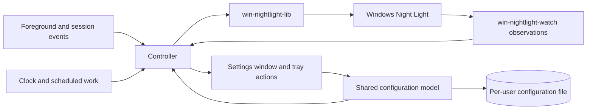

# Circadia

## Purpose and scope

Circadia is a Windows 11 tray app that controls native Windows Night Light with a user-defined daily temperature curve. The curve can follow sunrise, sunset, and the user's wake time. A user-selected application temporarily removes the tint while it has focus. The settings window and background controller run in one process using Windows Reactor, a Rust UI library for WinUI 3.

The app provides familiar f.lux scheduling and app-selection interactions through native Night Light. It does not write GPU gamma ramps or monitor calibration profiles. Whether native Night Light preserves the intended calibrated output, and whether 6500 K is optically equivalent to Night Light being off, remain display-validation questions.

**Goals:**

- Support an editable curve with arbitrary 1..N points connected by consecutive linear segments.
- Calculate solar events locally from coordinates saved independently of Windows Night Light.
- Suppress tint only for user-listed foreground applications, in any window mode.
- Keep background work event-driven and settings responsive.
- Favor straightforward implementations with few components and explicit state ownership.

**Non-goals:**

- Automatic fullscreen suppression in the minimum viable product (MVP); see Future work.
- Address search, paid geocoding, online solar APIs, or continuous location tracking in the MVP.
- Per-monitor temperature control, per-app suppression temperatures, or changes to calibration profiles.
- Using the Windows Night Light schedule to drive Circadia's curve.
- A service, elevated helper, watchdog, or separate settings process.

**Constraints:**

- Use Rust and one `windows-reactor` application process per user session.
- Read and write Night Light through `win-nightlight-lib`; observe decoded settings and state through `win-nightlight-watch`.
- Keep the Windows Night Light schedule disabled while Circadia successfully controls Night Light.
- Write temperatures only within the library's supported 1200 K to 6500 K range.
- Prefer direct code and existing library capabilities. Introduce additional components or general abstractions only for a demonstrated requirement or measured limitation.

**Dependencies:** Circadia selects `win-nightlight-lib` and `win-nightlight-watch` 0.4.0, published from `win-nightlight-cli` v0.4.0. This release provides the complete temperature refresh and decoded watcher snapshots used by the Night Light access requirements. The [dependency contracts](../research/nightlight-contracts.md) record the public APIs and their limits. A local solar-calculation library and the Reactor release remain implementation selections that require the validation listed below.

## Background and terms

Night Light stores its schedule and temperature in a settings value, and its on/off state in a separate state value. Updating one does not atomically update the other. Circadia requests their desired values and observes subsequent changes; it cannot prevent another Windows component from writing them.

The suppression list stores executable file names explicitly added by the user. Matching depends on current foreground identity, not window geometry, fullscreen mode, monitor arrangement, or display scaling.

| Term | Meaning |
| :-- | :-- |
| Curve point | A temperature and a time offset from sunrise, sunset, or the configured wake time. |
| Wake time | A user-selected daily clock time used as an anchor for curve points. |
| Scheduled temperature | The value obtained by evaluating the user's curve for the current instant. |
| Matching app | The current foreground app whose executable file name is on the suppression list. |
| Toggle delay | How long matching or nonmatching focus persists before suppression changes. |
| Suppression | The temporary override that sets the target to 6500 K for matching focus. |
| Target temperature | 6500 K during suppression; otherwise the current scheduled temperature. |
| Last written temperature | The last requested temperature known to have been stored successfully, including a write followed by a reported preview-cleanup failure. It is not a measurement of displayed color. |
| Intended temperature | The current fade step, or the target when no fade is active. |
| Preview flag | A native Night Light setting that the library toggles to request application of a temperature. |
| Temperature operation | One call to the public library operation that requests a temperature and its complete refresh. |
| Snapshot | A decoded settings or state record from a registry read. It is not an atomic capture of the write that signaled a watcher. |
| Control attempt | Fresh settings and state reads followed by the required owned-state writes and, when due, one temperature operation. Each fade step is a separate attempt. |
| Recompute event | An event requiring target reevaluation under [REQ-target-recompute](schedule.md#req-target-recompute--recompute-from-current-inputs), such as resume or a clock change. |
| Controller | The component that evaluates the curve and focus, serializes Night Light operations, and tracks errors. |
| Settings window | The on-demand editor within the same process as the controller and tray icon. |

Configuration persists across restarts. Focus history, pending delays, active fades, and the last written temperature are runtime state. Startup reconstructs control state from configuration, current focus, the clock, and fresh Night Light reads rather than resuming a persisted fade.

## Architecture overview

One process owns the configuration model, controller, tray icon, and settings window. The controller is the sole component that requests Night Light writes. Settings and tray actions update the shared model through the same validation and persistence path. Closing settings preserves the controller and tray icon.

Solar calculation, location requests, and registry observation do not block UI message handling. Thread placement, timer arrangement, and internal message types belong in implementation plans. Process separation is not required to keep background work running when settings closes.

## Invariants

### REQ-gamma-table-untouched — Preserve calibration data

Circadia changes screen color only through the Night Light library. It does not call APIs that modify GPU gamma ramps, display calibration, or monitor color profiles.

**Intent:** Use native Night Light without replacing calibration data through application-controlled color transforms.

**Scenarios:**

- An API trace covers scheduled changes, suppression, and fades: Circadia does not call gamma-ramp setters or calibration/profile mutation APIs.
- Calibration curves are read before and after normal control operations: the recorded values are unchanged. This check supplements, but does not replace, calibrated-output validation.

### REQ-app-owns-night-light — Maintain the desired Night Light state

When configuration is usable and Night Light access succeeds, the controller requests Night Light on, the native schedule off, and the intended temperature. After observing a deviation in an owned value, it restores that value from the current application state. It preserves unrelated settings through the library's update operations.

Read failures, write failures, and loss of observation follow the Night Light access requirements. They can prevent the desired values from being applied. Circadia reports that condition instead of reporting successful control. These guarantees do not prevent transient external writes or require successful cleanup after a crash.

**Scenarios:**

- Valid configuration is available and the native sunset schedule is enabled; control starts successfully: the native schedule is disabled and Circadia supplies the temperature.
- During normal control, the user changes the native schedule or on/off state: an observed difference causes Circadia to restore its desired state.
- Windows changes temperature during a fade: reconciliation uses the current intended fade step, not the fade's final target.
- A required registry read fails: the read-failure rule takes precedence over normal ownership writes.

### REQ-single-instance — One application instance per session

Only one instance controls Night Light in a user session. Starting Circadia again requests that the existing instance show its settings window. The second invocation does not write Night Light or create another controller.

**Scenarios:**

- Circadia is running in the tray; the user launches it from the Start menu: settings opens in the existing instance, and the target temperature does not change solely because of the launch.
- Settings is already open; the user launches Circadia again: the existing window is activated.

### REQ-game-process-isolation — Restrict access to other processes

Circadia reads only window metadata and process identity from other applications. It does not read or write their memory, inject code, or draw over their windows. Process handles request only limited-query access. Process and window discovery do not grant authority to modify those applications.

**Scenarios:**

- A game has focus while its executable is identified: an access-rights trace shows no process handle requesting memory access or modification rights.
- An elevated game selected for compatibility testing runs during suppression testing: Circadia uses the same limited-query behavior and does not load code into the game.

### REQ-unelevated-operation — Run without administrator rights

Circadia runs with the user's standard rights and does not request elevation to configure or control Night Light. An inaccessible foreground identity follows REQ-executable-list-match rather than triggering an elevation request.

**Scenarios:**

- The user launches Circadia from a standard account: startup and settings do not display a UAC prompt.
- Foreground identity lookup fails: the failure does not cause an elevated helper to start.

## Area specifications

| Area | Scope |
| :-- | :-- |
| [Location and daily temperature curve](schedule.md) | Coordinate entry, curve editing, solar evaluation, and recomputation. Read after the shared terms and invariants. |

## Application selection

### REQ-executable-list-match — Match listed foreground executables

A focused app matches only when its executable file name is on the user's suppression list. Matching is case-insensitive and uses the file name, not the full installation path or window title. Listed apps match in every window mode. An unlisted app does not match, even in fullscreen. A listed app running in the background does not trigger suppression.

**Failure behavior:** The app attempts identity lookup within its permitted access rights. If it cannot identify the executable, it treats the foreground app as nonmatching. It does not infer a match from an unrelated window title or request elevation. Any alternative identity lookup preserves these access and matching rules.

**Scenarios:**

- `VLC.EXE` is listed and a foreground window belongs to `vlc.exe`: it matches.
- A listed game gains focus in windowed, borderless fullscreen, or exclusive fullscreen mode: it matches in each mode.
- An unlisted game gains focus in fullscreen: it does not match.
- The list is empty: no application triggers suppression.
- A listed game remains running on one monitor while an unlisted browser has focus on another: the browser does not match.
- Two installations have the same listed executable file name: either matches when focused.

### REQ-edit-executable-list — Edit the suppression list

The suppression list starts empty. The user adds applications explicitly, either from recent foreground applications in the tray menu or by selecting an executable file in settings. The app saves the selected executable file name in its configuration and shows that matching name in the list. Settings lets the user remove entries. The MVP does not expose an automatic fullscreen suppression option or fullscreen-specific include and exclude lists.

The tray menu uses a history of previously focused applications so the user can add an app after switching away from it. Each entry identifies the application being added. Merely detecting an app does not add it to the suppression list. Circadia's own UI and desktop/taskbar interactions do not replace the application candidate the user switched away from.

**Failure behavior:** If the app cannot identify a recent application's executable, that candidate cannot be added through the menu. Manual executable selection remains available; runtime matching still requires successful identity lookup.

**Scenarios:**

- A game has focus; the user switches to another app and opens the tray menu: the menu lets the user select the game and add its executable.
- A game appears in the menu; the user closes the menu without selecting it: the suppression list does not change.
- Recent-app identification fails; the user selects the executable in settings and saves: the entry remains after restarting Circadia.
- The user removes an entry and saves: current focus is reevaluated, and that executable no longer matches.

## Suppression and fades

### REQ-suppress-on-focus — Suppress while focused

During suppression, the target temperature is 6500 K. Matching focus starts suppression after the toggle delay; nonmatching focus ends it after the toggle delay. Returning to the current matching state before the delay expires cancels the pending change. Moving directly between matching apps preserves suppression. When suppression ends, the target is the scheduled temperature for that instant.

The toggle delay filters brief focus changes. It does not add hysteresis or temperature bands to the scheduled curve. Its duration is an open decision.

**Scenarios:**

- A listed game remains focused beyond the toggle delay: the temperature fades toward 6500 K.
- The game keeps running while an unlisted browser on another monitor remains focused beyond the delay: the temperature fades toward the current scheduled value.
- During suppression, focus leaves the game and returns within the delay: suppression continues without a temperature change caused by that interruption.
- Focus moves directly between two listed apps: suppression continues, without a redundant temperature operation caused solely by that focus change.
- A listed game changes window mode without losing focus: suppression continues.

### REQ-transition-fade — Fade between temperatures

A target change caused by focus, configuration, or recomputation after an interruption starts a gradual fade from the last written temperature toward the new target. A new fade replaces an active fade and starts from its last written step. Normal progression along the scheduled linear curve does not start a separate fade at every update.

A fade returning to the schedule converges on the scheduled temperature at its completion time, then continues along that curve. Suppression remains the overriding target during a fade. Startup determines its origin under REQ-target-recompute.

**Permitted choices:** The number of steps, subject to measured library and display behavior. An optional setting can disable fades; when disabled, a target change issues one temperature operation. That operation can perform multiple registry writes internally. Fade duration and its default remain open decisions.

**Scenarios:**

- Suppression starts at night with fades enabled: recorded requested temperatures progress from the origin to 6500 K over the configured duration.
- Suppression ends halfway through a fade: the replacement fade starts from the last successfully written step rather than jumping to an earlier endpoint.
- The schedule rises during a fade back from suppression: the fade joins the curve at its completion time without a jump to an outdated target.
- Fades are disabled: a changed target issues one temperature operation rather than a sequence of intermediate operations.

## Night Light access

### REQ-temperature-refresh — Repeat the complete temperature refresh

Every explicit temperature operation calls `Nightlight::set_color_temperature` with the chosen kelvin value and `RefreshPolicy::Always` to request a complete preview-on/preview-off refresh. This applies even when the stored value already equals the request or preview was already active. Successful completion leaves preview off. Circadia serializes these operations with its other Night Light writes.

Success means the library reports completion of its writes; Circadia does not require optical verification or readback proof after each temperature operation. The app does not implement the undocumented registry format or access the library's private setters.

**Failure behavior:** Library errors follow REQ-night-light-write-failure. A later explicit operation requests the complete sequence again, without a separate preview-recovery subsystem.

**Scenarios:**

- The stored temperature equals the requested value and preview is already active: a successful operation still performs the refresh and finishes with preview off.
- The stored temperature differs: a successful operation stores the requested value and finishes the refresh.
- Night Light is inactive and the requested temperature is unchanged: the temperature operation still requests the complete refresh. Active-state control remains a separate operation.
- The library reports successful temperature storage followed by failed preview cleanup: the app records the partial success and displays the failure; its next explicit temperature operation requests the complete sequence again.

### REQ-night-light-observation — Reconcile observed owned values

Circadia creates separate settings and state watchers through `win-nightlight-watch`, registering both before the initial reads. When no read or write failure is pending, it consumes a notification through the library and compares the returned decoded snapshot's owned fields with the controller's current intention. The library rearms before reading. An observed difference in native schedule mode, active state, or intended temperature starts a control attempt that rereads both records and reevaluates the required repair. A notification alone does not request another temperature refresh.

Snapshots describe the later read, not the triggering write. Settings and state are independent observations, not an atomic pair. Notifications can combine writes, omit intermediate values, or produce repeated snapshots. Circadia reconciles observed values with its current intention; it does not count notifications, infer the writer, or replay intermediate values. Timestamp-only or preview-only differences do not trigger a refresh. During a fade, comparison uses the current intended step. An independently due temperature operation still follows REQ-temperature-refresh even when the stored kelvin value matches.

While a read or write failure is pending, Circadia uses the library's discard operation to consume and rearm notifications without reading snapshots. This includes notifications caused by partial writes or restoration of a missing value. Read/write reconciliation resumes only on an independent retry trigger listed in the failure requirements. That trigger reads current data even when no notification remains pending; discarded changes are not replayed.

**Failure behavior:** A watcher snapshot-read error follows REQ-night-light-read-failure and does not by itself mean notification registration was lost. If observation stops or cannot be armed, the app drops the failed watcher and displays the loss of observation. At the next focus change, scheduled temperature operation, configuration change, or recompute event, it attempts to restore observation and reads current state. It does not run an independent polling or recovery service. Successful registration for both values and fresh reads clear the observation error without clearing an unrelated write error.

**Scenarios:**

- A successful refresh causes notifications with matching owned values, including duplicate snapshots: no additional refresh is requested.
- An external writer enables the native schedule: the snapshot detects the difference; a control attempt rereads both records and disables the schedule if it is still enabled.
- Several temperature writes occur before one notification is consumed: reconciliation uses the returned value and current intended fade step, without replaying omitted temperatures.
- A queued snapshot differs from the current intention, but fresh control-attempt reads already match it: no repair write is issued solely because of the stale snapshot.
- A read or write failure is pending when a notification arrives: consuming it does not read a snapshot or start writes; the next independent retry trigger reads both records even without another notification.
- A watcher key becomes unavailable: status reports the problem; the next resume event attempts to reopen observation and reconcile current values.
- Observation is restored but a temperature write still fails: the observation error clears and the write error remains visible.

### REQ-night-light-read-failure — Stop writes when reads fail

Every control attempt, including each fade step, begins by reading and decoding both Night Light settings and state. A queued snapshot or a cached record does not satisfy these reads. A decoded `is_usable() == false` is diagnostic information and does not independently block writes; library read and write errors govern failure handling. If either read fails, it does not begin Night Light writes, cancels the active fade, and shows the error in the tray status and settings. A library operation that fails a later internal read follows the write-failure rule because earlier operations can already have succeeded.

The app retries reads at the next focus change, scheduled curve operation, accepted configuration change, or recompute event. Cancelled fade steps are not retry triggers. If no such event occurs, the error remains visible without a dedicated retry timer. Successful reads of both values clear the read error; a subsequent write failure is reported separately.

**Scenarios:**

- The settings format cannot be decoded at startup: the app reports the read failure and does not request writes.
- A read fails during a fade: remaining fade steps are cancelled; a later focus change reads again before attempting control.
- A watcher returns a snapshot-read error after rearming: the app reports a read failure, retains that watcher, and discards notifications without reads until an independent retry trigger.
- A missing value is restored during an unchanged, constant schedule: its notification does not bypass the pending failure; the next independent trigger retries reads.

### REQ-night-light-write-failure — Retry the required control operations

When an owned-state write or temperature operation fails, Circadia reports the failed operation and cancels the remaining fade steps. It preserves knowledge of any earlier successful writes, including a stored temperature followed by a preview-cleanup error. It does not report the entire control attempt as successful.

At the next focus change, scheduled curve operation, accepted configuration change, or recompute event, the controller reads current state and recomputes the current target. It retries the required schedule-off, state-on, and temperature operations, rather than retrying temperature alone. A successful full control attempt clears the corresponding write error.

**Scenarios:**

- Disabling the native schedule fails: status reports the failure; the next control attempt retries that operation before reporting successful ownership.
- Turning Night Light on fails but the temperature is stored: the next attempt still requests the required active state.
- A fade step fails: its remaining steps stop; the next independent trigger attempts the current target rather than an obsolete queued step.
- A partial temperature write generates a notification after preview cleanup fails: consuming that notification does not start another write attempt.
- A retry reads both values successfully but fails to activate Night Light: the read error clears and the write error remains visible.

## Configuration and application lifecycle

### REQ-configuration-reload — Apply valid configuration without restarting

Settings and tray actions validate configuration and persist it before publishing it to the shared controller. A successful save takes effect without restarting, including reevaluation of the current foreground app. External file changes are reloaded through the same validation path.

**Failure behavior:** Invalid, unreadable, or partly written configuration does not replace the last valid active configuration. A failed save preserves the prior saved configuration and reports the failure. On startup without usable configuration, REQ-initial-setup applies.

**Permitted choices:** The storage format and per-user file location. Document the selected schema and location before implementation depends on them.

**Scenarios:**

- The foreground executable is added through settings and saved: the controller reevaluates it immediately, then applies the normal focus delay.
- An external edit produces malformed configuration: the previous configuration stays active and the error appears in status.
- Saving new coordinates fails: settings reports the failure and the controller keeps using the prior coordinates.

### REQ-initial-setup — Wait for usable configuration

Without saved valid coordinates and a curve, Circadia does not modify Night Light and offers setup. A corrupt configuration file is not silently overwritten. Once usable configuration is saved, the controller starts from fresh Night Light reads and current focus.

A missing or out-of-range stored Night Light temperature uses 6500 K as the startup fade origin. When the saved curve cannot resolve for the current date and no valid scheduled temperature has been evaluated in this run, the fallback scheduled temperature is 6500 K and status explains the schedule problem. Suppression still takes precedence.

**Scenarios:**

- The user launches Circadia for the first time: setup is available and no Night Light writes occur until valid configuration is saved.
- Valid configuration exists, Night Light is active, and the stored temperature is absent or 7000 K: control uses 6500 K as its fade origin.
- A configured solar event cannot resolve on startup: status reports the unresolved schedule and the fallback is 6500 K.

### REQ-on-demand-settings — Open settings in the running process

The tray menu opens or activates a settings window in the existing Reactor process. Closing that window keeps the tray icon and controller running. Settings exposes coordinates, wake time, curve editing, the suppression list, sign-in startup, and current control or error status.

**Scenarios:**

- The user opens settings repeatedly: one settings window is shown in the running application instance.
- Settings closes during a fade: the same process continues the fade and handles later foreground changes.

### REQ-sign-in-start — Opt in to startup at sign-in

Start at sign-in is disabled by default. Enabling it registers Circadia for the current user's sign-in without administrator rights. Disabling it removes Circadia's own registration. A sign-in launch starts in the tray when usable configuration exists; incomplete setup remains accessible from the tray.

**Failure behavior:** A registration failure is shown to the user, and settings does not claim the requested registration succeeded.

**Scenarios:**

- A fresh configuration is created: Circadia does not register itself for sign-in startup.
- The user enables startup successfully and signs in again: one instance runs in the tray.
- The user disables startup successfully: the registration is removed and unrelated startup entries are unchanged.

### REQ-quit-cleanup — Attempt cleanup before exiting

Control begins when the first mutating public-library call is attempted after successful initial reads, including a call that reports failure or partial success. Failed initial reads alone do not begin control.

After control begins, Quit cancels normal scheduling and suppression work, fades toward 6500 K, and attempts to turn Night Light off. Session end attempts to turn it off without a fade. Cleanup does not restore the native schedule or the user's temperature from before Circadia took control.

Cleanup follows the read guard and records failed operations. Failure to fade does not prevent an off attempt when reads permit it. Exit is not delayed indefinitely by retries or failed cleanup. Quitting before control begins does not modify Night Light.

A crash or forced termination can leave Night Light at its last stored state until Circadia restarts or the user changes it. The app has no watchdog and does not promise cleanup after forced termination.

**Scenarios:**

- Normal control is active and cleanup succeeds: Quit fades to 6500 K, requests Night Light off, and exits.
- Session end allows cleanup and its reads and write succeed: Night Light is turned off without a fade.
- The off write fails: the failure is recorded and the app exits without claiming successful cleanup.
- First-run setup is closed and the user quits: Night Light remains unchanged.

## Efficiency and structure

### REQ-lean-background — Measure the single process's resource use

Circadia uses one Reactor process for settings and background control. It does not create a second UI process or helper to meet an assumed memory target. Resource validation measures the running process with settings initially closed, open, and closed again.

**Scenarios:**

- A representative release build is measured in all three settings states: the report includes working set, private bytes, CPU time, and context switches, with the Windows build, observation duration, and active schedule recorded.
- Settings closes after editing: background control continues in the same process. The report does not assume all WinUI resources unload.

### REQ-event-driven-idle — Schedule work when inputs change

Foreground matching uses focus events and executable identity. Night Light observation uses change notifications. Timed work serves pending focus delays, fades, and the daily curve. The controller does not poll foreground identity, window geometry, or fullscreen presentation mode on a recurring timer.

On a constant portion of the curve with stable focus, no active fade, and no relevant events, the controller does not repeatedly write temperature. It schedules the next necessary curve or calendar evaluation. The number of internal timers is an implementation choice.

**Scenarios:**

- The curve is constant for ten minutes and the user types without changing focus: tracing shows no periodic foreground queries or repeated temperature operations.
- The curve has a nonzero slope: scheduled operations follow that curve without depending on a focus event.
- The system resumes: current focus and the curve are reevaluated even if no foreground event arrives.

## Security

Coordinates, executable names, and preferences are stored per user. Circadia does not upload them. Windows location services can use Microsoft's location infrastructure under the user's Windows permissions; the app requests only the explicit one-time lookup in REQ-current-location.

Circadia writes its configuration, diagnostics, current-user Night Light values, and its optional sign-in registration. The controller alone requests Night Light writes. It does not execute a selected suppression-list file merely because the user adds it. Process inspection is restricted by REQ-game-process-isolation and REQ-unelevated-operation. Compatibility with every anti-cheat product is outside the guarantee; representative elevated-game tests remain necessary.

## Future work

**Automatic fullscreen suppression:** A future version could suppress for an unlisted foreground app that covers a monitor. It is outside the MVP and does not block its implementation. The [fullscreen detection research](../research/fullscreen-detection.md) records candidate APIs, controlled probe results, and their limits.

That follow-up needs mixed-DPI and multi-monitor testing, same-window mode transitions, shell-overlay evaluation, and checks for maximized-window false positives. Its default and controls for excluding particular apps require a separate decision.

**Address search:** A future provider integration can fill the same coordinate fields. The MVP uses manual entry and Windows location, without an API key or paid service.

## Open questions

These items prevent final approval of the affected requirements. Implementation plans do not silently select their user-visible behavior.

- **Invalid schedule boundaries:** Define which Windows calendar date is invalid when conflicting points cross midnight, and when interpolation involving that date becomes valid again. Define when a missing solar point invalidates evaluation despite other points bracketing the current time. Retaining the last valid scheduled temperature is selected; silently skipping missing points is not an approved substitute. Affects REQ-solar-schedule.
- **Interaction timing:** Set the focus toggle delay, fade duration/default, and whether the optional fade-disable control is included. The fade validation below informs feasible values. Affects REQ-suppress-on-focus and REQ-transition-fade.
- **Recent-app menu:** Set the history length, ordering, and whether closed apps remain candidates. The menu must preserve the app the user switched away from. Affects REQ-edit-executable-list.
- **Tray status:** Select the visible states and failure presentation, including simultaneous suppression and errors. Affects REQ-on-demand-settings and the Night Light failure requirements.

The following evidence is still required; it is not a request to reconsider settled product choices:

- **Display validation:** Compare calibrated output with Night Light off, scheduled temperatures, and 6500 K in SDR and HDR. An unchanged gamma-table read alone does not prove equivalent display output. Determines whether the product approach meets its calibration goal.
- **Fade validation:** Measure visible response, useful step cadence, interruption behavior, and native interaction after repeated refreshes. Future registry timestamps alone do not prove Windows ignores later native changes.
- **Solar calculation:** Select and validate a local calculation dependency, its sunrise/sunset convention, high-latitude results, and date/time-zone conversion. Record reproducible reference cases.
- **Foreground identity:** Test standard and elevated games, process exits, packaged/hosted apps, and shell overlays. The defined fallback remains nonmatching when identity cannot be resolved; a host name is not proof of the application's executable.
- **Reactor lifecycle and resources:** Verify tray lifetime after settings closes, second-launch activation, deployment, and measured idle use with the selected release. Do not use missing measurements to reintroduce a second process by default.

## Explored alternatives

- **Automatic fullscreen suppression in the MVP:** Explicit executable rules cover the initial use case without geometry monitoring and its compatibility work.
- **Separate settings and controller processes:** One Reactor process provides the selected lifecycle with shared configuration and fewer components. Measurements can identify actual resource problems before adding process separation.
- **Raw Win32 settings controls:** Reactor is the selected UI library; native tray integration does not require a separate raw-Win32 settings implementation.
- **Windows native sunset scheduling:** Independent Windows writes can compete with Circadia's curve, so Circadia disables that schedule while controlling Night Light.
- **Paid geocoding or online solar services:** Manual coordinates, Windows location, and local calculation meet the MVP scope without provider billing or online schedule availability.
- **Suppression while a listed process runs:** Background execution does not indicate that the user is interacting with the app; the selected rule requires foreground focus.
- **Watchdog recovery after crashes:** The user accepts the last stored state until restart or manual intervention. A second process is not required for this recovery contract.
- **Gamma-ramp temperature control:** The product uses native Night Light to avoid application writes to calibration transforms.

## Supporting evidence

The [research index](../research/README.md) links dated evidence, alternatives, and measurement limits. Research recommendations are informative and do not override the requirements here.

| Requirements | Evidence | Limit |
| :-- | :-- | :-- |
| Night Light ownership, refresh, and failure requirements | [v0.4.0 refresh and snapshot contracts](../research/nightlight-contracts.md) | Establishes the released APIs and tested error behavior, not optical output, fade cadence, or atomic event snapshots. |
| Curve and application selection requirements | [f.lux behavior](../research/flux-behavior.md) | Does not establish an arbitrary-point algorithm or current private implementation. |
| Location and solar schedule requirements | [Location and solar times](../research/location-and-solar-times.md) | Candidate libraries still require reference-case validation. |
| Settings and resource requirements | [Desktop process architecture](../research/desktop-process-architecture.md) | Does not supply Circadia resource measurements. |

## References

- [`win-nightlight-cli` v0.4.0](https://github.com/kvnxiao/win-nightlight-cli/tree/v0.4.0)
- [`windows-reactor`](https://github.com/microsoft/windows-rs/tree/master/crates/libs/reactor)
- [`SetWinEventHook`](https://learn.microsoft.com/en-us/windows/win32/api/winuser/nf-winuser-setwineventhook)
- [`QueryFullProcessImageNameW`](https://learn.microsoft.com/en-us/windows/win32/api/winbase/nf-winbase-queryfullprocessimagenamew)

## Conformance

A conforming implementation satisfies every requirement and invariant in this spec and its area files, the constraints and non-goals in Purpose and scope, the component responsibilities in Architecture overview, and the access limits in Security. Present-tense statements in these parts are mandatory. Uppercase SHOULD marks a recommendation an implementation may decline with a documented reason; uppercase MAY marks an allowed option. Text labeled Example or Note, Background and terms, Open questions, Future work, Explored alternatives, Supporting evidence, the architecture diagram, and linked research are informative. Terms bind through the requirements that use them.
