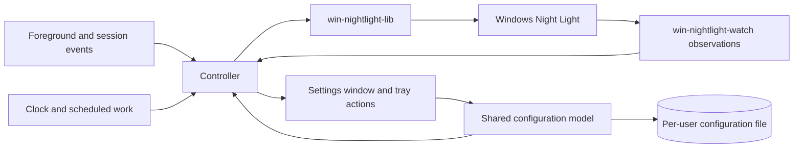

# Circadia

## Purpose and scope

Circadia is a Windows 11 tray app that manages native Windows Night Light with a generated daily temperature curve. Users configure Daytime, Morning/Evening, and Sleep temperatures, required Wake and Bedtime clocks, and optional Sunrise and Sunset timing. Transitions finish by each target time, so evening warmth can begin hours before Bedtime. Users can temporarily request 6500 K for a listed foreground application or for one hour through the tray menu. The settings window and background controller run in one process using Windows Reactor, a Rust UI library for WinUI 3.

The target audience is active during the day and sleeps once overnight. A bedtime after midnight is supported. Night-shift schedules and multiple daily sleep periods are outside the minimum viable product (MVP)'s intended use.

Circadia does not write GPU gamma ramps or monitor calibration profiles. Successful library operations and decoded registry readback verify native requests. A visible temperature benchmark separately checks that Windows applies those requests to the display. Instrumented optical measurements, calibration preservation by Windows, and optical equivalence between 6500 K and Night Light off are outside the acceptance criteria.

**Goals:**

- Generate gradual transitions between three ordered temperature levels, with each target reached by its stated time.
- Keep Wake and Bedtime under user control while optional solar timing follows the seasons.
- Omit unavailable or conflicting solar targets and shorten transitions when targets are close together.
- Suppress tint for user-listed foreground applications in any window mode, or through a one-hour manual toggle.
- Keep background work event-driven and settings responsive.
- Favor straightforward implementations with few components and explicit state ownership.

**Non-goals:**

- Automatic fullscreen suppression in the MVP; see Future work.
- Pausing control by turning Night Light off while Circadia remains running. Manual suppression requests 6500 K with Night Light on.
- Arbitrary curve-point editing, user-defined offsets, extra fixed-clock targets, or weekday-specific schedules.
- Night-shift scheduling, multiple daily sleep periods, city/address search, or automatic location tracking.
- Per-monitor temperature control, per-app suppression temperatures, or changes to calibration profiles.
- Using the Windows Night Light schedule to drive Circadia's curve.
- A service, elevated helper, watchdog, or separate settings process.

**Constraints:**

- Use Rust and one `windows-reactor` application process per user session. The MVP targets Windows 11 x64, build 22000 or later, and distributes the required native Windows App SDK runtime alongside the executable.
- Read and write Night Light through `win-nightlight-lib`; observe decoded settings and state through `win-nightlight-watch`.
- Request the Windows Night Light schedule off during control. Errors and exit do not restore or enable that schedule.
- Write temperatures only within the library's supported 1200 K to 6500 K range.
- Prefer direct code and existing library capabilities. Introduce additional components or general abstractions only for a demonstrated requirement or measured limitation.

**Dependencies:** Circadia uses `win-nightlight-lib` and `win-nightlight-watch` 0.4.0, plus `windows-reactor` and `windows-reactor-setup` pinned together to `windows-rs` revision `722f202100c3bd428627941d3834d87ad6679d1c`. Supporting evidence links the capability assessments, API contracts, and deployment research.

## Background and terms

Night Light stores its schedule and temperature in a settings value, and its on/off state in a separate state value. Updating one does not atomically update the other. Circadia requests their desired values and observes subsequent changes; it cannot prevent another Windows component from writing them.

The suppression list stores executable file names explicitly added by the user. Matching depends on current foreground identity, not window geometry, fullscreen mode, monitor arrangement, or display scaling.

| Term | Meaning |
| :-- | :-- |
| Temperature level | Daytime, Morning/Evening, or Sleep, ordered from highest to lowest kelvin. Morning and evening share one value. |
| Schedule target | A Wake, Bedtime, Sunrise, or Sunset occurrence selected for the curve, with the temperature reached at that instant. |
| Scheduled transition | The linear temperature change before a target, using the shared maximum duration or a shorter available interval. |
| Scheduled temperature | The value obtained by evaluating the generated curve for the current instant. |
| Wake/Bedtime-only curve | The curve with both solar targets omitted; Wake reaches Daytime and Bedtime reaches Sleep. |
| Solar timing enabled | Sunrise, Sunset, or both inputs are enabled. Each input has its own switch. |
| Last scheduled temperature | The last successfully stored value from the accepted schedule or its temporary fallback. Suppression, Preview, benchmark, and intermediate fade writes do not replace it. The final fade step counts when it reaches the accepted schedule or fallback. Storage counts even if the following native-preview cleanup fails. |
| Frozen temperature | The last scheduled temperature captured when Windows time-zone acquisition or conversion prevents schedule evaluation, preserved until recovery. |
| Suspended control | Temperature control stopped because time-zone evaluation failed before a last scheduled temperature was established. Settings remains available and evaluation can be retried. |
| Matching app | The current foreground app whose executable file name is included and not excluded from automatic suppression. |
| Foreground change | A change of foreground window, including switches between two nonmatching apps. It is an event before the focus delay is applied. |
| Focus delay | The global duration for which matching or nonmatching focus persists before suppression changes. |
| Automatic suppression | The suppression source established by matching focus, subject to the focus delay after startup. |
| Manual suppression | The independent, runtime-only one-hour suppression source controlled by the tray toggle. |
| Suppression | The temporary 6500 K override, active when automatic suppression, manual suppression, or both are active. |
| Target temperature | 6500 K during suppression; otherwise the benchmark, playback, or scheduled temperature. Calculation failures follow the control area's failure rules. |
| Last written temperature | The last requested temperature known to have been stored successfully, including a write followed by a reported preview-cleanup failure. It is not a measurement of displayed color. |
| Intended temperature | The quantized temperature of the last issued output step, used as the observation baseline until the next permitted output is issued. Each new step rounds the current fade step or target to the nearest 10 K under REQ-temperature-refresh. |
| Native preview flag | A Night Light setting that the library toggles to request application of a temperature, distinct from Circadia's Preview playback. |
| Schedule playback | The Preview button's ten-second traversal of the next 24 hours of the draft curve. |
| Preview benchmark | A separate visible temperature sweep that measures complete native control attempts; it does not evaluate or save a draft schedule. |
| Temperature operation | One call to the public library operation that requests a temperature and its complete refresh. |
| Owned values | Native schedule disabled, Night Light active, and the intended temperature. All other settings are unrelated to Circadia's ownership. |
| Control attempt | Fresh settings and state reads followed by required owned-value writes and, when due, one temperature operation. Each emitted fade step is a separate attempt. Graceful exit has a state-only exception. |
| Ordinary fade | A fade governed by the user's global enable switch and duration. Startup has a separate duration; scheduled interpolation is not an ordinary fade. |
| Fade origin | The temperature from which a fade starts, normally the last written temperature. Startup can instead use the freshly read native temperature. |
| Accepted configuration | The validated configuration currently used for scheduling and automatic suppression. Its accepted schedule is the curve generated from those inputs, including the permitted solar fallback. |
| Saved configuration | The configuration on disk. A malformed external edit can differ from the accepted configuration. |
| Draft | Unsaved settings edits, separate from the accepted configuration. |
| Usable configuration | Configuration with valid clocks, ordered temperatures, durations, preferences, and coordinates when solar timing is enabled. Its runtime calculations can still fail. |
| Startup prerequisites | Usable configuration plus successful Windows time-zone acquisition and conversion sufficient to evaluate its current curve. Solar failure permits a Wake/Bedtime-only fallback. |
| Night Light access begun | The controller has passed startup prerequisites and entered native initialization, immediately before attempting watcher registration and initial reads. It remains true for that process run even if those operations fail or control is later suspended. |
| Recompute event | An event requiring target reevaluation under [REQ-target-recompute](control.md#req-target-recompute--recompute-from-current-inputs), such as resume or a clock change. |
| Explicit retry action | The settings Retry action, a request to start Preview or its benchmark, a successful Save, or a user toggle of manual suppression. It can retry native access immediately, subject to serialization and the existing control/access guards. |
| Native recovery | Automatic retries after a native read, write, or observation failure, with delays of 100, 200, 400, then 800 ms under REQ-native-recovery. |
| Clock gap / repeated interval | Local clock times skipped by a forward offset change / displayed twice by a backward offset change. |
| Confirmed session end | Windows' notification that sign-out, shutdown, restart, or closure for servicing will proceed, distinct from its earlier query. |
| Controller | The component that evaluates the curve and focus, serializes Night Light operations, and tracks errors. |
| Settings window | The on-demand editor within the same process as the controller and tray icon. |

Configuration persists across restarts. Focus history, pending delays, manual suppression and its deadline, active fades, and stored-temperature baselines are runtime state. Startup reconstructs control state from configuration, current focus, the clock, and fresh Night Light reads rather than resuming a persisted fade or timer.

## Architecture overview

One process owns the configuration model, controller, tray icon, and settings window. The controller is the sole component that requests Night Light writes. Settings and tray configuration edits use the same validation and persistence path. Manual suppression changes runtime state without saving configuration. Closing settings preserves the controller and tray icon.

The controller selects one temperature source in this order:

1. Either suppression source requests 6500 K.
2. Otherwise, a running Preview benchmark or schedule playback supplies its temperature.
3. Otherwise, the accepted schedule or its frozen temperature applies.

Benchmark and schedule playback cannot run together. Suspended control prevents temperature writes from every source until scheduling becomes evaluable. Settings, editing, and native recovery status remain available.

Schedule evaluation and registry observation do not block UI message handling. Thread placement, timer arrangement, and internal message types belong in implementation plans. Process separation is not required to keep background work running when settings closes.

## Invariants

### REQ-gamma-table-untouched — Preserve calibration data

Circadia changes screen color only through the Night Light library. It does not call APIs that modify GPU gamma ramps, display calibration, or monitor color profiles.

**Intent:** Use native Night Light without replacing calibration data through application-controlled color transforms.

**Scenarios:**

- An API trace covers scheduled changes, suppression, and fades: Circadia does not call gamma-ramp setters or calibration/profile mutation APIs.
- An API trace covers the visible benchmark and restoration: Circadia makes native Night Light requests without gamma-ramp setters or calibration/profile mutation calls. Changes that Windows itself makes to the live display transform do not violate this invariant.

### REQ-event-driven-idle — Perform background work only when needed

Circadia minimizes CPU use by scheduling work for input events, necessary output changes, or an explicitly active operation. Foreground identity uses focus events and Night Light observation uses change notifications. Stable focus does not cause recurring process or window inspection. Curve output waits for its next 10 K change or relevant schedule boundary instead of sampling at a fixed rate.

Constant output does not cause repeated temperature operations. Resume requires its discrete complete refresh under REQ-suspend-resume, including at an unchanged temperature. Suppression stops underlying curve-output timers after reaching 6500 K. Schedule inputs are still recalculated on relevant configuration, date, clock, and resume events. Other timed work is limited to focus delays, manual suppression expiry, changing fades or playback, the user-started benchmark, and pending native recovery. Native recovery stops after success; unchanged errors do not produce repeated identical diagnostics. Hidden settings do not animate their graph or update a countdown.

**Scenarios:**

- A constant schedule and stable focus continue for ten minutes: tracing shows no periodic foreground queries, temperature writes, graph animation, or native retry work.
- A one-hour 6500 K to 2400 K transition runs without interruptions: output follows its 410 distinct 10 K changes, without a recurring 50 ms sampler.
- A listed game remains focused over a scheduled transition: underlying intermediate temperature writes and their timers stop. A date change still recomputes required schedule inputs once.
- A native error persists: only the native recovery sequence and explicit user actions attempt recovery; curve ticks and self-generated notifications do not create additional attempts.
- Settings closes during manual suppression: the hour still expires, but its hidden countdown does not generate recurring UI updates.

### REQ-app-owns-night-light — Maintain the desired Night Light state

After startup prerequisites pass, with successful Night Light access, the controller requests Night Light on, the native schedule off, and the intended temperature. Suppression uses 6500 K while Night Light remains enabled. Circadia requests off only during graceful exit under [REQ-exit-night-light-off](control.md#req-exit-night-light-off--turn-night-light-off-on-graceful-exit). After observing a deviation, the controller restores the owned value from the current application state. It preserves unrelated settings through the library's update operations.

Startup prerequisites follow REQ-startup-temperature. Read, write, and observation failures follow the Night Light access requirements. External writers can cause transient deviations. Control ends when graceful exit begins.

**Scenarios:**

- Valid configuration is available and the native sunset schedule is enabled; control starts successfully: the native schedule is disabled and Circadia supplies the temperature.
- While Circadia controls Night Light, the user changes the native schedule or on/off state: an observed difference causes Circadia to restore its desired state.
- Windows changes temperature during a fade: reconciliation uses the current intended fade step, not the fade's final target.
- Windows changes temperature while control has a constant intention: reconciliation restores that intention immediately, without starting an ordinary fade.
- A required registry read fails: the read-failure rule takes precedence over normal ownership writes.

### REQ-single-instance — One application instance per session

Only one instance controls Night Light in a user session. Starting Circadia again requests that the existing instance show its settings window. The second invocation does not write Night Light or create another controller.

**Scenarios:**

- Circadia is running in the tray; the user launches its executable or a shortcut again: settings opens in the existing instance, and the target temperature does not change solely because of the launch.
- Settings is already open; the user launches Circadia again: the existing window is activated.

### REQ-game-process-isolation — Restrict access to other processes

Circadia reads only window metadata and process identity from other applications. It does not read or write their memory, inject code, or draw over their windows. Process handles request only limited-query access. Process and window discovery do not grant authority to modify those applications.

**Scenarios:**

- A game has focus while its executable is identified: an access-rights trace shows no process handle requesting memory access or modification rights.
- An elevated game selected for compatibility testing runs during suppression testing: Circadia uses the same limited-query behavior and does not load code into the game.

### REQ-unelevated-operation — Run without administrator rights

Circadia runs with the user's standard rights and does not request elevation to configure or control Night Light. An inaccessible foreground identity follows REQ-executable-list-match rather than triggering an elevation request.

**Scenarios:**

- The user launches Circadia from a standard account: startup and settings do not display a UAC prompt.
- Foreground identity lookup fails: the failure does not cause an elevated helper to start.

## Area specifications

| Area | Scope |
| :-- | :-- |
| [Daily temperatures, Wake, Bedtime, and solar timing](schedule.md) | Pure schedule inputs, clock conversion, solar selection, and generated transitions. Read after the shared terms and invariants. |
| [Automatic and manual suppression](suppression.md) | Executable identity, inclusion and exclusion lists, focus delay, and the one-hour toggle. Read after the root. |
| [Native Night Light access](native-access.md) | Serialized refresh, observation, inactive preparation, and read/write failures. Read after the root. |
| [Temperature control and lifecycle](control.md) | Startup, fades, schedule failures, recomputation, suspend/resume, and exit. Read after schedule, suppression, and native access. |
| [Configuration and application interface](application.md) | Persistence, setup, settings, graph, Preview and its benchmark, launch preferences, and resource use. Read after control and its dependencies. |

## Security

Wake and Bedtime clocks, temperature levels, coordinates, executable names, and preferences are stored per user. Circadia does not upload them or call a daily solar service. **Use current location** explicitly requests Windows location access; that operating-system service can use network-backed positioning. Manual coordinates and disabled solar timing do not require location permission.

Diagnostics are local per-user records of operation type, timestamp, and technical error code or sanitized error category. They exclude coordinates, executable identities, window titles, and personal file paths, including those embedded in library error messages. Record the first failure of an operation/category, a change of category, and its recovery. Identical consecutive failures do not append records. A diagnostics-write failure does not recursively log itself or prevent control, editing, or exit. Settings provides a way to open the diagnostics location. The exact local format and location are permitted implementation choices; diagnostics are not uploaded automatically.

All error and degraded-operation messages appear inside settings. The tray icon remains static and the tray menu reports ordinary control and suppression status without errors. Circadia does not show error popups or error notifications, or open settings in response to a background failure. An explicit launch without usable configuration still opens setup under REQ-initial-setup.

Circadia writes its configuration, diagnostics, current-user Night Light values, and its optional sign-in registration. The controller alone requests Night Light writes. It does not execute a selected suppression-list file merely because the user adds it. Process inspection is restricted by REQ-game-process-isolation and REQ-unelevated-operation. Compatibility with every anti-cheat product is outside the guarantee; representative elevated-game tests remain necessary.

## Future work

**Automatic fullscreen suppression:** A future version could suppress for an unlisted foreground app that covers a monitor. It is outside the MVP and does not block its implementation. The [fullscreen detection research](../research/fullscreen-detection.md) records candidate APIs, controlled probe results, and their limits.

That follow-up needs mixed-DPI and multi-monitor testing, same-window mode transitions, shell-overlay evaluation, and checks for maximized-window false positives. Its default and controls for excluding particular apps require a separate decision.

**Location search and travel:** City/address search and automatic travel tracking require separate product and provider decisions. The MVP uses manually entered coordinates or an explicit Windows location request, then keeps the saved coordinates until the user changes them.

**Dynamic tray icons:** A future version can show the current day or night phase. The MVP uses a static icon.

**Additional schedule controls:** Separate morning/evening temperatures, per-transition durations, and arbitrary user points are outside the MVP. The schedule uses one middle temperature and one shared scheduled-transition duration.

**Configurable Preview duration:** The MVP uses a fixed 10-second schedule playback. A later version can expose its duration if use demonstrates a need.

## Explored alternatives

- **Arbitrary points and offsets:** A general curve editor exposes ordering and collision decisions that the intended daily schedule does not need. Three ordered temperatures and generated transitions provide the selected user experience.
- **Transitions starting at their target time:** This reaches the desired temperature too late. The schedule instead reaches each retained temperature by its anchor time.
- **Moving Sunset to an earlier Bedtime:** This preserves an unnecessary middle target. Omitting Sunset lets the app generate the complete transition to Sleep before Bedtime.
- **Repeated solar-driven cycles:** Following every crossing can add another warming/cooling cycle within one waking day. Solar targets are limited to one morning and one evening between Wake and the following Bedtime.
- **Synthetic solar times during polar conditions:** Backup clocks or reused events would imply a solar event that does not occur. Missing events are omitted while Wake and Bedtime remain user-controlled.
- **Freezing or blocking on solar calculation failure:** A Wake/Bedtime-only fallback keeps scheduling, editing, and Preview available while settings reports the solar error. Losing a solar target can change the current temperature; ordinary recomputation fades apply during control.
- **Fixed-rate sampling throughout long transitions:** Scheduling the next 10 K output change avoids repeated calculation and duplicate refreshes between steps.
- **Using the slowest display as the fade ceiling:** The fastest active display defines the ceiling so slower side displays do not limit transitions on the main display. Serialized calls still limit actual throughput.
- **Preserving tint on ordinary Quit:** Keeping the last active temperature permits warmth after automation stops, but can leave bedtime tint active after exit. Explicit Quit uses the same off request as confirmed Windows session end.
- **Resuming queued temperature steps:** Relative waits can exclude suspended time. Resume evaluates the current curve and discards obsolete steps instead of prolonging a transition by the suspended interval.
- **Skipping resume refresh when records match:** Stored values do not verify displayed color after resume. A discrete complete refresh explicitly reapplies the current intended output.
- **Persistent solar caches:** Multi-location caches introduce retention, location matching, invalidation, and persistence behavior. The selected design calculates required dates locally from the current saved coordinates.
- **Omitting manual targets in a clock gap:** Omitting Wake or Bedtime can prolong the preceding temperature through an entire day. Elapsed-interval adjustment preserves the target and its ordinary separation from the preceding manual target.
- **Shifting every remaining target on a clock-change day:** This unnecessarily shifts the evening routine after an overnight change. The next target returns to its configured clock unless doing so would collapse or reverse the manual target order.

## Implementation and release validation

These checks establish implementation conformance and release readiness. Spec approval does not establish that the implementation passes them.

**During implementation:** Verify the complete application against the requirement scenarios:

- Temperature ordering, clock and duration validation, solar omission and selection, shortened transitions, and conversion of local dates and clock times to actual instants.
- Explicit location permission, manual coordinates, failed location requests, and local solar calculation across ordinary and polar dates.
- Validation of unsaved settings for the generated graph, Preview, and Save; Preview entry/exit and cancellation.
- Actual Shell interaction, second-launch activation, Explorer restart, settings closure, and shutdown.
- Suspend/resume across partial transitions, multiple dates, and clock changes; suppression expiry, interrupted playback, native failures, missing advance suspend notice, and repeated resume notifications under REQ-suspend-resume.

Verify graph latency, due output deadlines, rate ceilings, serialized writes, retry delays, and the visible benchmark against their requirements. Resource measurements have no numerical pass threshold; REQ-event-driven-idle is an invariant. The release maintainer declares and records each reference machine's hardware, Windows build, display modes, and build profile before collecting acceptance results.

**Note:** The Windows Reactor UI probe uses predefined anchor times; it does not verify the complete application.

**Before release:** Verify clean-machine deployment on the minimum and a current serviced Windows 11 build, resource use, display scaling, accessibility, and foreground matching across representative applications, window modes, and elevation levels.

Include these Windows checks:

- Exercise sleep, hibernation, hybrid sleep, and Modern Standby on hardware that supports each state, recording unavailable states. Verify resume delivery with settings closed and without relying on unlock, fresh native reads, unchanged-temperature refresh, and visible output after resuming. Record notification, native-operation, and display-response timing separately; do not infer visible restoration from registry equality. Distinguish restoration of an existing process from startup after Fast Startup.
- On fresh profiles on build 22000 and a current supported build, test Night Light access before opening its native settings. Distinguish missing keys, missing values, and decode errors. Record any verified native initialization action and recovery through automatic or explicit retry. Do not prescribe opening Windows settings as a remedy without verifying that it initializes the missing data. Missing data follows the same settings-only error and retry behavior.
- Exercise Quit after a temperature operation reports failed native-preview cleanup. Verify the serialized exit attempt and decoded state, including whether the native preview flag remains set. An off state does not prove untinted display output; the exit contract accepts that limitation.
- Run the visible benchmark with a single display and mixed-refresh displays. Record visible changes in both directions, operation timings, the ceiling, and any missing or erratic response. Successful registry operations with an ineffective visible sweep fail this check and require an implementation or rate adjustment before release.

## Supporting evidence

The [research index](../research/README.md) records feasibility findings, versions, API details, measurements, and limitations. The [probe index](../../probes/README.md) links reproducible experiments and their run instructions. They support the design without adding requirements or proving complete application conformance.

| Design decision or requirement | Evidence |
| :-- | :-- |
| Windows Reactor for the generated graph, settings, and tray | [UI capabilities and native integration](../research/windows-reactor-ui.md) |
| Native Night Light ownership, refresh, and failures | [Library and watcher contracts](../research/nightlight-contracts.md), [runtime timing and readback](../research/nightlight-runtime.md) |
| Output precision, rate ceiling, benchmark, and retry timing | [Temperature update cadence](../research/temperature-update-cadence.md) |
| Suspend/resume timing and native refresh | [Windows suspend and resume](../research/suspend-resume.md); notification ordering and visible restoration remain implementation and release checks. |
| Startup fade and Windows exit notifications | [Session shutdown and startup restoration](../research/session-shutdown.md); source inspection does not establish cleanup success during shutdown or the next sign-in's display state. |
| Local dates and clock times mapped to actual instants | [Clock conversion fixtures](../research/windows-clock-conversion.md), [host-setting checks](../research/schedule-integration.md#host-setting-exercise), and [elapsed-interval reasoning](../research/clock-change-intervals.md); the target-adjustment policy is not exercised by the existing probe. |
| Optional solar timing and explicit coordinate acquisition | [Local solar calculation](../research/solar-calculation.md), [location APIs](../research/location-and-solar-times.md); the probes do not verify the generated schedule's event-selection rules. |
| Local calculation without persistent solar caches | [Measured per-date calculation cost](../research/solar-performance.md); four dates on one desktop do not establish a universal latency bound. |
| Windows 11 build 22000 minimum | [Dependency and runtime compatibility](../research/windows-compatibility.md) |
| One process for settings and background control | [Desktop process architecture](../research/desktop-process-architecture.md) |
| Scheduling and application-selection interactions | [f.lux comparison](../research/flux-behavior.md) |
| One-hour manual suppression | [Elapsed-time source and resume limits](../research/timed-suppression.md) |
| Hosted executable identity | [Window ownership and limited-query resolution](../research/hosted-application-identity.md); representative application coverage remains unverified. |

## Conformance

A conforming implementation satisfies every requirement and invariant in this spec and its area files, the constraints and non-goals in Purpose and scope, the component responsibilities in Architecture overview, the requirements in Security, and the transitions in each diagram that lists every transition. Implementation and release validation obligations bind at their stated stages. Present-tense statements in these parts are mandatory. Uppercase SHOULD marks a recommendation an implementation may decline with a documented reason; uppercase MAY marks an allowed option. Text and diagrams labeled Example or Note, Background and terms, Explored alternatives, Future work, Supporting evidence, the architecture diagram, and linked research are informative. Terms bind through the requirements that use them.
