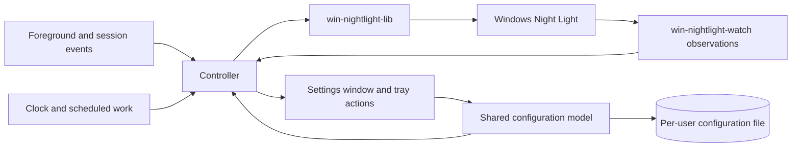

# Circadia

## Purpose and scope

Circadia is a Windows 11 tray app that manages native Windows Night Light with a generated daily temperature curve. Users configure Daytime, Morning/Evening, and Sleep temperatures, required Wake and Bedtime clocks, and optional Sunrise and Sunset timing. Transitions finish by each retained target time, so evening warmth can begin hours before Bedtime. A user-selected application temporarily removes the tint while it has focus. The settings window and background controller run in one process using Windows Reactor, a Rust UI library for WinUI 3.

The target audience is active during the day and sleeps once overnight. A bedtime after midnight is supported. Night-shift schedules and multiple daily sleep periods are outside the MVP's intended use.

Circadia does not write GPU gamma ramps or monitor calibration profiles. Successful library operations and decoded registry readback provide the acceptance evidence for temperature changes. Display response, calibration preservation by Windows, and optical equivalence between 6500 K and Night Light off are accepted assumptions; they do not require colorimeter, SDR, or HDR measurements before approval.

**Goals:**

- Generate gradual transitions between three ordered temperature levels, with each target reached by its stated time.
- Keep Wake and Bedtime under user control while optional solar timing follows the seasons.
- Omit unavailable or conflicting solar targets and shorten transitions when targets are close together.
- Suppress tint only for user-listed foreground applications, in any window mode.
- Keep background work event-driven and settings responsive.
- Favor straightforward implementations with few components and explicit state ownership.

**Non-goals:**

- Automatic fullscreen suppression in the minimum viable product (MVP); see Future work.
- Arbitrary curve-point editing, user-defined offsets, extra fixed-clock targets, or weekday-specific schedules.
- Night-shift scheduling, multiple daily sleep periods, city/address search, or automatic location tracking.
- Per-monitor temperature control, per-app suppression temperatures, or changes to calibration profiles.
- Using the Windows Night Light schedule to drive Circadia's curve.
- A service, elevated helper, watchdog, or separate settings process.

**Constraints:**

- Use Rust and one `windows-reactor` application process per user session. The MVP targets Windows 11 x64, build 22000 or later, and distributes the required native Windows App SDK runtime alongside the executable.
- Read and write Night Light through `win-nightlight-lib`; observe decoded settings and state through `win-nightlight-watch`.
- Keep the Windows Night Light schedule disabled while Circadia successfully controls Night Light.
- Write temperatures only within the library's supported 1200 K to 6500 K range.
- Prefer direct code and existing library capabilities. Introduce additional components or general abstractions only for a demonstrated requirement or measured limitation.

**Dependencies:** Circadia uses `win-nightlight-lib` and `win-nightlight-watch` 0.4.0, plus `windows-reactor` and `windows-reactor-setup` pinned together to `windows-rs` revision `722f202100c3bd428627941d3834d87ad6679d1c`. Supporting evidence links the capability assessments, API contracts, and deployment research.

## Background and terms

Night Light stores its schedule and temperature in a settings value, and its on/off state in a separate state value. Updating one does not atomically update the other. Circadia requests their desired values and observes subsequent changes; it cannot prevent another Windows component from writing them.

The suppression list stores executable file names explicitly added by the user. Matching depends on current foreground identity, not window geometry, fullscreen mode, monitor arrangement, or display scaling.

| Term | Meaning |
| :-- | :-- |
| Temperature level | Daytime, Morning/Evening, or Sleep, ordered from highest to lowest kelvin. Morning and evening share one value. |
| Time anchor | A required user-entered Wake or Bedtime clock, or an optional calculated Sunrise or Sunset event. |
| Activity interval | Wake through the following Bedtime, which can cross midnight. |
| Schedule target | A retained anchor's time and the temperature the generated curve reaches at that time. |
| Scheduled transition | The linear temperature change before a target, using the shared maximum duration or a shorter available interval. |
| Scheduled temperature | The value obtained by evaluating the generated curve for the current instant. |
| Frozen temperature | The last successfully written temperature captured when required schedule calculation fails, used until recovery. |
| Matching app | The current foreground app whose executable file name is on the suppression list. |
| Focus delay | The global duration for which matching or nonmatching focus persists before suppression changes. |
| Suppression | The temporary override that sets the target to 6500 K for matching focus. |
| Target temperature | 6500 K during suppression; otherwise the playback or scheduled temperature. Calculation failures follow the schedule area's failure rules. |
| Last written temperature | The last requested temperature known to have been stored successfully, including a write followed by a reported preview-cleanup failure. It is not a measurement of displayed color. |
| Intended temperature | The current fade step, or the target when no fade is active, rounded to integer kelvin under REQ-temperature-refresh. |
| Preview flag | A native Night Light setting that the library toggles to request application of a temperature. |
| Schedule playback | The Preview button's accelerated traversal of the temperature curve, distinct from the native preview flag. |
| Temperature operation | One call to the public library operation that requests a temperature and its complete refresh. |
| Snapshot | A decoded settings or state record from a registry read. It is not an atomic capture of the write that signaled a watcher. |
| Control attempt | Fresh settings and state reads followed by the required owned-state writes and, when due, one temperature operation. Each fade step is a separate attempt. |
| Recompute event | An event requiring target reevaluation under [REQ-target-recompute](schedule.md#req-target-recompute--recompute-from-current-inputs), such as resume or a clock change. |
| Controller | The component that evaluates the curve and focus, serializes Night Light operations, and tracks errors. |
| Settings window | The on-demand editor within the same process as the controller and tray icon. |

Configuration persists across restarts. Focus history, pending delays, active fades, and the last written temperature are runtime state. Startup reconstructs control state from configuration, current focus, the clock, and fresh Night Light reads rather than resuming a persisted fade.

## Architecture overview

One process owns the configuration model, controller, tray icon, and settings window. The controller is the sole component that requests Night Light writes. Settings and tray actions update the shared model through the same validation and persistence path. Closing settings preserves the controller and tray icon.

Schedule evaluation and registry observation do not block UI message handling. Thread placement, timer arrangement, and internal message types belong in implementation plans. Process separation is not required to keep background work running when settings closes.

## Invariants

### REQ-gamma-table-untouched — Preserve calibration data

Circadia changes screen color only through the Night Light library. It does not call APIs that modify GPU gamma ramps, display calibration, or monitor color profiles.

**Intent:** Use native Night Light without replacing calibration data through application-controlled color transforms.

**Scenarios:**

- An API trace covers scheduled changes, suppression, and fades: Circadia does not call gamma-ramp setters or calibration/profile mutation APIs.
- Calibration curves are read before and after control operations: the recorded values are unchanged. This checks stored calibration data; physical display output remains an accepted assumption.

### REQ-app-owns-night-light — Maintain the desired Night Light state

After startup prerequisites pass, with successful Night Light access, the controller requests Night Light on, the native schedule off, and the intended temperature. Suppression uses 6500 K while Night Light remains enabled. Circadia requests off only during graceful exit under [REQ-exit-night-light-off](application.md#req-exit-night-light-off--turn-night-light-off-on-graceful-exit). After observing a deviation, the controller restores the owned value from the current application state. It preserves unrelated settings through the library's update operations.

Startup prerequisites follow REQ-startup-temperature. Read, write, and observation failures follow the Night Light access requirements. External writers can cause transient deviations. Control ends when graceful exit begins.

**Scenarios:**

- Valid configuration is available and the native sunset schedule is enabled; control starts successfully: the native schedule is disabled and Circadia supplies the temperature.
- While Circadia controls Night Light, the user changes the native schedule or on/off state: an observed difference causes Circadia to restore its desired state.
- Windows changes temperature during a fade: reconciliation uses the current intended fade step, not the fade's final target.
- A required registry read fails: the read-failure rule takes precedence over normal ownership writes.

### REQ-single-instance — One application instance per session

Only one instance controls Night Light in a user session. Starting Circadia again requests that the existing instance show its settings window. The second invocation does not write Night Light or create another controller.

**Scenarios:**

- Circadia is running in the tray; the user launches it from the Start menu: settings opens in the existing instance, and the target temperature does not change solely because of the launch.
- Settings is already open; the user launches Circadia again: the existing window is activated.

### REQ-game-process-isolation — Restrict access to other processes

Circadia reads only window metadata and process identity from other applications. It does not read or write their memory, inject code, or draw over their windows. Process handles request only limited-query access. Process and window discovery do not grant authority to modify those applications.

**Scenarios:**

- A game has focus while its executable is identified: an access-rights trace shows no process handle requesting memory access or modification rights.
- An elevated game selected for compatibility testing runs during suppression testing: Circadia uses the same limited-query behavior and does not load code into the game.

### REQ-unelevated-operation — Run without administrator rights

Circadia runs with the user's standard rights and does not request elevation to configure or control Night Light. An inaccessible foreground identity follows REQ-executable-list-match rather than triggering an elevation request.

**Scenarios:**

- The user launches Circadia from a standard account: startup and settings do not display a UAC prompt.
- Foreground identity lookup fails: the failure does not cause an elevated helper to start.

## Area specifications

| Area | Scope |
| :-- | :-- |
| [Daily temperatures, Wake, Bedtime, and solar timing](schedule.md) | Temperature levels, clocks, location, solar targets, generated transitions, graph, playback, and recomputation. Read after the shared terms and invariants. |
| [Configuration and application lifecycle](application.md) | Configuration persistence, setup, settings, shutdown, and resource behavior. Read with the shared Night Light access requirements. |

## Application selection

### REQ-executable-list-match — Match listed foreground executables

A focused app matches only when its executable file name is on the user's suppression list. Matching is case-insensitive and uses the file name, not the full installation path or window title. Listed apps match in every window mode. An unlisted app does not match, even in fullscreen. A listed app running in the background does not trigger suppression.

**Failure behavior:** The app attempts identity lookup within its permitted access rights. If it cannot identify the executable, it treats the foreground app as nonmatching. It does not infer a match from an unrelated window title or request elevation. Any alternative identity lookup preserves these access and matching rules.

**Scenarios:**

- `VLC.EXE` is listed and a foreground window belongs to `vlc.exe`: it matches.
- A listed game gains focus in windowed, borderless fullscreen, or exclusive fullscreen mode: it matches in each mode.
- An unlisted game gains focus in fullscreen: it does not match.
- The list is empty: no application triggers suppression.
- A listed game remains running on one monitor while an unlisted browser has focus on another: the browser does not match.
- Two installations have the same listed executable file name: either matches when focused.

### REQ-edit-executable-list — Edit the suppression list

The suppression list starts empty. The user adds applications explicitly, either from recent foreground applications in the tray menu or by selecting an executable file in settings. The app saves the selected executable file name in its configuration and shows that matching name in the list. Settings lets the user remove entries. The MVP does not expose an automatic fullscreen suppression option or fullscreen-specific include and exclude lists.

The tray menu stores the five most recent distinct executable file names in most-recent-first order so the user can add an app after switching away from it. Closed apps remain candidates; the history resets when Circadia exits. Each entry identifies the application being added. Merely detecting an app does not add it to the suppression list. Circadia's own UI and desktop/taskbar interactions do not replace the application candidate the user switched away from.

**Failure behavior:** If the app cannot identify a recent application's executable, that candidate cannot be added through the menu. Manual executable selection remains available; runtime matching still requires successful identity lookup.

**Scenarios:**

- A game has focus; the user switches to another app and opens the tray menu: the menu lets the user select the game and add its executable.
- A game appears in the menu; the user closes the menu without selecting it: the suppression list does not change.
- Recent-app identification fails; the user selects the executable in settings and saves: the entry remains after restarting Circadia.
- The user removes an entry and saves: current focus is reevaluated, and that executable no longer matches.
- Six distinct apps receive focus: the history retains the latest five. Refocusing one moves it to the front without creating a duplicate; closing it keeps it available until displaced or Circadia exits.

## Suppression and fades

### REQ-suppress-on-focus — Suppress while focused

During suppression, the target temperature is 6500 K. Matching focus starts suppression after the focus delay; nonmatching focus ends it after the focus delay. If focus returns to the matching or nonmatching state that established the current suppression state before the delay expires, the pending change is canceled. Moving directly between matching apps preserves suppression. When suppression ends, the target follows active schedule playback if present; otherwise it is the scheduled temperature for the actual current instant. The ordinary focus-transition fade applies. Activating suppression cancels schedule playback under REQ-preview-temperature-curve.

Once suppression is active, the controller suspends ordinary scheduled-temperature updates. It does not evaluate the hidden temperature curve or calculate solar events on recurring schedule ticks. Input changes mark the schedule for recomputation when suppression ends. The focus delay, a fade toward 6500 K, and Night Light observation continue to serve their existing purposes.

When suppression ends, the controller evaluates the schedule at that actual instant. It does not restore the temperature from before suppression or replay missed transitions. If a scheduled transition is in progress, control resumes at its interpolated temperature and continues the remaining transition. The ordinary focus fade converges on the schedule under REQ-transition-fade.

The focus delay filters brief focus changes. It does not add hysteresis or temperature bands to the scheduled curve. The user configures one global focus delay, initially 250 ms, within the inclusive range 0–5000 ms. A zero delay changes suppression immediately.

**Scenarios:**

- Fades are enabled and a listed game remains focused beyond the focus delay: the temperature fades toward 6500 K.
- The game keeps running while an unlisted browser on another monitor remains focused beyond the delay: the temperature fades toward the current scheduled value.
- During suppression, focus leaves the game and returns within the delay: suppression continues without a temperature change caused by that interruption.
- Focus moves directly between two listed apps: suppression continues, without a redundant temperature operation caused solely by that focus change.
- A listed game changes window mode without losing focus: suppression continues.
- With the default 250 ms delay, focus leaves a listed app for 200 ms and returns: suppression continues without a new fade.
- A game remains focused from evening into the hour before Bedtime: after reaching 6500 K, the controller does not run hidden temperature updates at each scheduled step.
- Evening is 3400 K and occurs at least 60 minutes before Bedtime; Sleep is 2200 K and the scheduled duration is 60 minutes. Suppression ends 30 minutes before Bedtime: the schedule evaluates to 2800 K at that instant and continues toward 2200 K. Night Light remains enabled throughout.
- A game closes or focus moves to an unlisted application after several scheduled transitions have passed: once the focus delay expires, the controller evaluates the current instant without replaying those transitions.
- A 5000 ms focus delay is ending suppression after switching to settings, and Preview starts before it expires: suppression retains its 6500 K target until the delay ends. The target then follows the active playback with the ordinary focus fade. Preview still ends at its ten-second deadline and immediately returns to the accepted schedule.
- A delay of 0 or 5000 ms is accepted; a negative value or a value above 5000 ms blocks Save and preserves the active configuration.

### REQ-transition-fade — Fade between temperatures

With fades enabled, a target change caused by focus, configuration, or recomputation after an interruption such as resume or a clock change starts a gradual fade from the last written temperature toward the new target. A new fade replaces an active fade and starts from its last written step. Normal progression along the scheduled linear curve, including accelerated schedule playback, does not start a separate fade at every update.

A fade returning to normal scheduling or active playback converges on that curve's temperature at the fade's completion time, then continues along it. If playback ends first, its immediate exit rule cancels the unfinished fade. Suppression remains the overriding target during a fade. Startup follows [REQ-startup-temperature](application.md#req-startup-temperature--apply-the-current-temperature-at-startup).

Settings provides a global fade enable/disable switch and one global fade duration. Fades are initially enabled with a duration of 500 ms; the inclusive duration range is 100–10,000 ms. These controls apply to focus changes, accepted configuration changes, and recomputation after interruptions such as resume or clock changes. They do not add per-point transitions or replace scheduled interpolation. Schedule playback starts and stops without these fades under REQ-preview-temperature-curve. With ordinary fades disabled, these target changes issue one temperature operation, which can perform multiple registry writes internally.

**Permitted choices:** Fade step count and cadence, within the configured duration and serialized Night Light access rules.

**Scenarios:**

- Suppression starts at night with fades enabled: recorded requested temperatures progress from the origin to 6500 K over the configured duration.
- Suppression ends halfway through a fade: the replacement fade starts from the last successfully written step rather than jumping to an earlier endpoint.
- The schedule rises during a fade back from suppression: the fade joins the curve at its completion time without a jump to an outdated target.
- Fades are disabled: a changed override or configuration target issues one temperature operation. Ordinary progression along a sloped curve still interpolates continuously.
- The scheduled transition duration is 60 minutes: evening and bedtime transitions use that maximum independently of the global fade duration.
- A new configuration uses enabled 500 ms fades. A stable focus change starts its fade after the default 250 ms focus delay.
- A duration of 100 or 10,000 ms is accepted; 99 or 10,001 ms blocks Save and preserves the active configuration.

## Night Light access

### REQ-temperature-refresh — Repeat the complete temperature refresh

The controller rounds the current fade step, or the target when no fade is active, to the nearest integer kelvin; exact half-kelvin ties round toward the higher temperature. Native writes and readback comparison use this integer intended temperature. Curve and fade calculations retain fractional precision; output rounding does not snap to the editor's 10 K increments or change those calculations.

Every explicit temperature operation requests the intended temperature and the library's unconditional, complete preview-on/preview-off refresh. This applies even when the stored value already equals the request or preview was already active. Successful completion leaves preview off. Circadia serializes these operations with its other Night Light writes.

Success means the library reports completion of its writes; Circadia does not require optical verification or readback proof after each temperature operation. The app does not implement the undocumented registry format or access the library's private setters.

**Failure behavior:** Library errors follow REQ-night-light-write-failure. A later explicit operation requests the complete sequence again, without a separate preview-recovery subsystem.

**Scenarios:**

- A curve value or fade step of 4002.49 K has an intended temperature of 4002 K; 4002.5 K has an intended temperature of 4003 K. Writes and readback comparison use the same integer.
- The stored temperature equals the requested value and preview is already active: a successful operation still performs the refresh and finishes with preview off.
- The stored temperature differs: a successful operation stores the requested value and finishes the refresh.
- Night Light is inactive and the requested temperature is unchanged: the temperature operation still requests the complete refresh. Active-state control remains a separate operation.
- The library reports successful temperature storage followed by failed preview cleanup: the app records the partial success and displays the failure; its next explicit temperature operation requests the complete sequence again.

### REQ-night-light-observation — Reconcile observed owned values

Circadia creates separate settings and state watchers through `win-nightlight-watch`, registering both before the initial reads. When no read or write failure is pending, it consumes a notification through the library and compares the returned decoded snapshot's owned fields with the controller's current intention. An observed difference in native schedule mode, active state, or intended temperature starts a control attempt that rereads both records and reevaluates the required repair. A notification alone does not request another temperature refresh.

Snapshots describe the later read, not the triggering write. Settings and state are independent observations, not an atomic pair. Notifications can combine writes, omit intermediate values, or produce repeated snapshots. Circadia reconciles observed values with its current intention; it does not count notifications, infer the writer, or replay intermediate values. Timestamp-only or preview-only differences do not trigger a refresh. Temperature comparison uses the integer intended temperature defined by REQ-temperature-refresh, including during a fade. An independently due temperature operation still follows REQ-temperature-refresh even when the stored kelvin value matches.

While a read or write failure is pending, Circadia consumes notifications without reading snapshots and rearms observation through the library. This includes notifications caused by partial writes or restoration of a missing value. Read/write reconciliation resumes only on an independent retry trigger listed in the failure requirements. That trigger reads current data even when no notification remains pending; discarded changes are not replayed.

**Failure behavior:** A watcher snapshot-read error follows REQ-night-light-read-failure and does not by itself mean notification registration was lost. If observation stops or cannot be armed, the app drops the failed watcher and displays the loss of observation. At the next focus change, scheduled temperature operation, configuration change, or recompute event, it attempts to restore observation and reads current state. It does not run an independent polling or recovery service. Successful registration for both values and fresh reads clear the observation error without clearing an unrelated write error.

**Scenarios:**

- A successful refresh causes notifications with matching owned values, including duplicate snapshots: no additional refresh is requested.
- The curve evaluates to 4002.5 K and a successful operation stores 4003 K. While that intended temperature remains unchanged, matching owned values in subsequent snapshots do not request a repair, including duplicate notifications.
- The current fade step is 3350.5 K and the stored temperature is 3351 K. Matching owned values do not request an extra operation before the next independently due fade step. That next step still requests the complete refresh, even if it rounds to 3351 K again.
- An external writer enables the native schedule: the snapshot detects the difference; a control attempt rereads both records and disables the schedule if it is still enabled.
- Several temperature writes occur before one notification is consumed: reconciliation compares the returned value with the current integer intended temperature, without replaying omitted temperatures.
- A queued snapshot differs from the current intention, but fresh control-attempt reads already match it: no repair write is issued solely because of the stale snapshot.
- A read or write failure is pending when a notification arrives: consuming it does not read a snapshot or start writes; the next independent retry trigger reads both records even without another notification.
- A watcher key becomes unavailable: status reports the problem; the next resume event attempts to reopen observation and reconcile current values.
- Observation is restored but a temperature write still fails: the observation error clears and the write error remains visible.

### REQ-night-light-read-failure — Stop writes when reads fail

Every control attempt, including each fade step, begins by reading and decoding both Night Light settings and state. A queued snapshot or a cached record does not satisfy these reads. The decoded state's library usability diagnostic (`State::is_usable()`) does not independently block writes; library read and write errors govern failure handling. If either read fails, it does not begin Night Light writes, cancels the active fade and schedule playback, and shows the error in the tray status and settings. A library operation that fails a later internal read follows the write-failure rule because earlier operations can already have succeeded.

The app retries reads at the next focus change, scheduled curve operation, accepted configuration change, or recompute event. Canceled fade or playback steps and failure-triggered playback cancellation are not retry triggers. If no such event occurs, the error remains visible without a dedicated retry timer. Successful reads of both values clear the read error; a subsequent write failure is reported separately.

Graceful exit uses its single cleanup attempt under REQ-exit-night-light-off, including the same fresh-read guard.

**Scenarios:**

- The settings format cannot be decoded at startup: the app reports the read failure and does not request writes.
- A read fails during a fade: remaining fade steps are cancelled; a later focus change reads again before attempting control.
- A watcher returns a snapshot-read error after rearming: the app reports a read failure, retains that watcher, and discards notifications without reads until an independent retry trigger.
- A missing value is restored during an unchanged, constant schedule: its notification does not bypass the pending failure; the next independent trigger retries reads.

### REQ-night-light-write-failure — Retry the required control operations

When an owned-state write or temperature operation fails, Circadia reports the failed operation and cancels the remaining fade and playback steps. It preserves knowledge of any earlier successful writes, including a stored temperature followed by a preview-cleanup error. It does not report the entire control attempt as successful.

At the next focus change, scheduled curve operation, accepted configuration change, or recompute event, the controller reads current state and recomputes the current target. It retries the required schedule-off, state-on, and temperature operations, rather than retrying temperature alone. A successful full control attempt clears the corresponding write error.

Graceful exit follows REQ-exit-night-light-off instead of retrying normal control operations.

**Scenarios:**

- Disabling the native schedule fails: status reports the failure; the next control attempt retries that operation before reporting successful ownership.
- Turning Night Light on fails but the temperature is stored: the next attempt still requests the required active state.
- A fade step fails: its remaining steps stop; the next independent trigger attempts the current target rather than an obsolete queued step.
- A partial temperature write generates a notification after preview cleanup fails: consuming that notification does not start another write attempt.
- A retry reads both values successfully but fails to activate Night Light: the read error clears and the write error remains visible.

## Security

Wake and Bedtime clocks, temperature levels, coordinates, executable names, and preferences are stored per user. Circadia does not upload them or call a daily solar service. Use current location explicitly requests Windows location access; that operating-system service can use network-backed positioning. Manual coordinates and disabled solar timing require no location permission.

Circadia writes its configuration, diagnostics, current-user Night Light values, and its optional sign-in registration. The controller alone requests Night Light writes. It does not execute a selected suppression-list file merely because the user adds it. Process inspection is restricted by REQ-game-process-isolation and REQ-unelevated-operation. Compatibility with every anti-cheat product is outside the guarantee; representative elevated-game tests remain necessary.

## Future work

**Automatic fullscreen suppression:** A future version could suppress for an unlisted foreground app that covers a monitor. It is outside the MVP and does not block its implementation. The [fullscreen detection research](../research/fullscreen-detection.md) records candidate APIs, controlled probe results, and their limits.

That follow-up needs mixed-DPI and multi-monitor testing, same-window mode transitions, shell-overlay evaluation, and checks for maximized-window false positives. Its default and controls for excluding particular apps require a separate decision.

**Location search and travel:** City/address search and automatic travel tracking require separate product and provider decisions. The MVP uses manually entered coordinates or an explicit Windows location request, then keeps the saved coordinates until the user changes them.

**Dynamic tray icons:** A future version can show the current day or night phase. The MVP uses a static icon.

**Additional schedule controls:** Separate morning/evening temperatures, per-transition durations, and arbitrary user points are outside the MVP. The schedule uses one middle temperature and one shared scheduled-transition duration.

**Configurable preview duration:** The MVP uses a fixed 10-second schedule playback. A later version can expose its duration if use demonstrates a need.

## Explored alternatives

- **Arbitrary points and offsets:** A general curve editor exposes ordering and collision decisions that the intended daily schedule does not need. Three ordered temperatures and generated transitions provide the selected user experience.
- **Transitions starting at their target time:** This reaches the desired temperature too late. The schedule instead reaches each retained temperature by its anchor time.
- **Moving Sunset to an earlier Bedtime:** This preserves an unnecessary middle target. Omitting Sunset lets the app generate the complete transition to Sleep before Bedtime.
- **Repeated solar-driven cycles:** Following every crossing can add another warming/cooling cycle within one waking day. Solar targets are limited to one morning and one evening between Wake and the following Bedtime.
- **Synthetic solar times during polar conditions:** Backup clocks or reused events would imply a solar event that does not occur. Missing events are omitted while Wake and Bedtime remain user-controlled.
- **Waiting for solar recovery before startup control:** Waiting can preserve a stale bedtime tint and prevent app suppression. A temporary Wake/Bedtime-only schedule keeps control available while the solar error remains visible.
- **Preserving tint on ordinary Quit:** Keeping the last active temperature permits warmth after automation stops, but can leave bedtime tint active after exit. Explicit Quit uses the same off request as confirmed Windows session end.
- **Persistent solar caches:** Multi-location caches introduce retention, location matching, invalidation, and persistence behavior. The selected design calculates required dates locally from the current saved coordinates.

## Implementation and release validation

These checks establish implementation conformance and release readiness. Spec approval does not establish that the implementation passes them.

**During implementation:** Verify the complete application against the requirement scenarios:

- Temperature ordering, clock and duration validation, solar omission and selection, shortened transitions, and conversion of local dates and clock times to actual instants.
- Explicit location permission, manual coordinates, failed location requests, and local solar calculation across ordinary and polar dates.
- Validation of unsaved settings for the generated graph, Preview, and Save; Preview entry/exit and cancellation.
- Actual Shell interaction, second-launch activation, Explorer restart, settings closure, and shutdown.

Measure the time from schedule-setting input to the updated graph.

**Note:** The Windows Reactor UI probe uses predefined anchor times; it does not verify the complete application.

**Before release:** Verify clean-machine deployment on the minimum and a current serviced Windows 11 build, resource use, display scaling, accessibility, and foreground matching across representative applications, window modes, and elevation levels.

These acceptance checks remain required. Implementation plans assign their tasks and concrete verification steps.

## Supporting evidence

The [research index](../research/README.md) records feasibility findings, versions, API details, measurements, and limitations. The [probe index](../../probes/README.md) links reproducible experiments and their run instructions. They support the design without adding requirements or proving complete application conformance.

| Design decision or requirement | Evidence |
| :-- | :-- |
| Windows Reactor for the generated graph, settings, and tray | [UI capabilities and native integration](../research/windows-reactor-ui.md) |
| Native Night Light ownership, refresh, and failures | [Library and watcher contracts](../research/nightlight-contracts.md), [runtime timing and readback](../research/nightlight-runtime.md) |
| Startup fade and Windows exit notifications | [Session shutdown and startup restoration](../research/session-shutdown.md); source inspection does not establish cleanup success during shutdown or the next sign-in's display state. |
| Local dates and clock times mapped to actual instants | [Clock conversion fixtures and host-setting checks](../research/windows-clock-conversion.md) |
| Optional solar timing and explicit coordinate acquisition | [Local solar calculation](../research/solar-calculation.md), [location APIs](../research/location-and-solar-times.md); the probes do not verify the generated schedule's event-selection rules. |
| Local calculation without persistent solar caches | [Measured per-date calculation cost](../research/solar-performance.md); four dates on one desktop do not establish a universal latency bound. |
| Windows 11 build 22000 minimum | [Dependency and runtime compatibility](../research/windows-compatibility.md) |
| One process for settings and background control | [Desktop process architecture](../research/desktop-process-architecture.md) |
| Scheduling and application-selection interactions | [f.lux comparison](../research/flux-behavior.md) |

## Conformance

A conforming implementation satisfies every requirement and invariant in this spec and its area files, the constraints and non-goals in Purpose and scope, the component responsibilities in Architecture overview, and the access limits in Security. Implementation and release validation obligations bind at their stated stages. Present-tense statements in these parts are mandatory. Uppercase SHOULD marks a recommendation an implementation may decline with a documented reason; uppercase MAY marks an allowed option. Text and diagrams labeled Example or Note, Background and terms, Explored alternatives, Future work, Supporting evidence, the architecture diagram, and linked research are informative. Terms bind through the requirements that use them.
