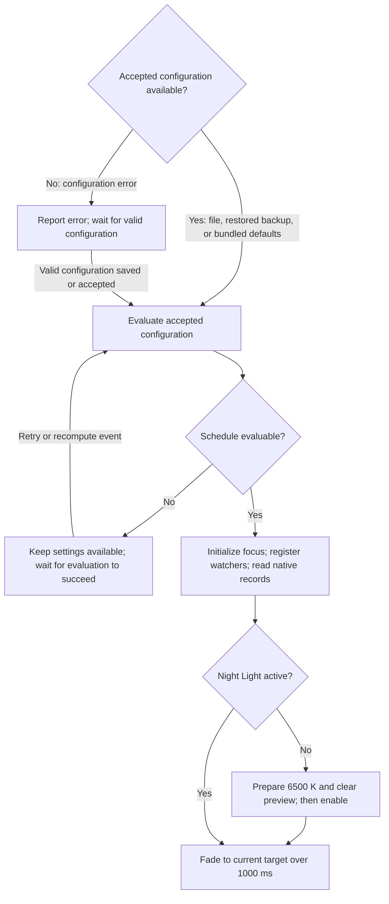

# Temperature control and lifecycle

Read [SPEC.md](SPEC.md), [schedule calculation](schedule.md), [suppression](suppression.md), and [native access](native-access.md) before this area.

## Startup and temperature changes

### REQ-startup-temperature — Apply the current temperature at startup

Startup obtains the accepted configuration (the configuration file, a restored backup, or bundled defaults) and evaluates its current schedule before beginning Night Light access. Without an accepted configuration, Night Light access does not begin. Solar failure permits the Wake/Bedtime-only fallback; time-zone failure follows REQ-schedule-evaluation-failure. Current focus does not defer calculation. Once prerequisites pass, automatic suppression initializes from current focus without the focus delay.

Night Light access begins immediately before watcher registration and initial reads. Both watchers are attempted before those reads. Registration failure follows native recovery without preventing otherwise usable control. This milestone remains true even if later operations fail.

Successful fresh reads select the startup origin:

- If Night Light is off, inactive preparation writes 6500 K with the native preview flag off, then Circadia requests on and fades toward the current target.
- If Night Light is on with a valid stored temperature, fade from that temperature.
- If Night Light is on but the decodable settings record has an absent or unsupported temperature, use 6500 K as the origin.

The startup fade lasts 1000 ms from its actual start and reaches the target at completion. Missing or undecodable records remain read failures. Equal origin and target require application but no artificial delay. A failed inactive preparation prevents activation. A Preview request during startup replaces it with Preview's immediate target after the same access checks pass.

Startup completes after native schedule disablement, activation, and the current target application or transition succeed. Intermediate storage alone does not complete it. A suppression fade that replaces startup completes startup when it succeeds. Before completion, recovery selects an origin from fresh reads and current inputs. Later native recovery uses the ordinary transition rules.

**Note:** This diagram summarizes startup; every failed native operation follows native recovery.



**Scenarios:**

- Neither the configuration file nor its backup exists and Night Light is off at night: defaults supply the schedule, 6500 K is prepared before activation, and the 1000 ms fade approaches the current scheduled value.
- Inactive preparation fails: the attempt does not request on.
- Night Light is active at 2200 K and the target is 6500 K: startup fades over 1000 ms independently of the ordinary fade duration.
- Origin already equals the target: startup applies it without waiting one second solely to mark completion.
- Initial reads fail and retry reads active 3000 K: the fresh origin is 3000 K, not a cached default.
- A listed game is focused with a 5000 ms focus delay: startup initializes suppression immediately after prerequisites pass.
- A suppression fade replaces startup and succeeds: later native errors use ordinary recovery.
- Time-zone acquisition fails before Night Light access begins: settings and Retry remain available, and Quit skips native cleanup.

### REQ-transition-fade — Fade between ordinary target changes

Starting or ending the suppression override, recomputations, native recovery, and accepted configuration changes outside a live draft use an ordinary fade. Settings exposes its duration, initially 500 ms, accepting whole milliseconds from 100 through 10,000. Ordinary fades are always enabled. Scheduled interpolation and Preview progression do not start a separate fade at every update.

A fade normally starts at the last successfully stored temperature. A confirmed external temperature deviation uses the fresh observed origin under REQ-repeated-native-changes. A fade replaced by a new target begins at the last stored step.

A fade returning to a schedule converges on that schedule's temperature at the fade's completion instant, then continues the curve. Suppression retains precedence. Duration defines a logical endpoint; synchronous call latency can delay completion of a request, but missed intermediate values are skipped rather than extending the fade.

Live draft edits apply their current target immediately without a fade. Preview entry, completion, Stop, and Discard also request their selected target immediately without an additional fade. Save adopts already-live settings without restarting their transition. When suppression follows Preview, the transition follows REQ-suppress-on-focus. Suspend and exit use their own lifecycle rules.

A read or write failure stops remaining steps and attempts pending preview cleanup. Recovery selects the current target and uses startup rules until initial target application succeeds; afterward it uses an ordinary fade from the last written value when available. Preview recovery applies the current playback value immediately. Restoring observation alone does not restart a successful fade.

A final matching successful output does not require duplicate temperature storage merely to mark completion. Native-preview cleanup remains required.

**Scenarios:**

- Suppression starts at night: output progresses toward 6500 K over the configured duration.
- Suppression ends halfway through that fade: the replacement starts from the last stored step and converges on the active schedule at completion.
- The draft's temperature changes while settings is open: output changes immediately without a fade; Save does not repeat the same transition.
- Save succeeds halfway through an ordinary fade driven by the live draft: the fade keeps its current progress and original completion deadline after adoption.
- Duration is 100 or 10,000 ms: it is valid. Values outside the range or fractional milliseconds are rejected.
- External interference occurs during a constant segment: correction fades from its fresh origin; further interference does not restart the deadline.
- Preview ends with unsaved edits: output returns immediately to the current live draft. Discard later selects the current accepted schedule immediately.
- Recovery restores only a watcher while output continues: the existing fade retains its original deadline.

### REQ-temperature-cadence — Request only due temperature changes

Settings provides an output-rate ceiling, initially 60 Hz, accepting whole numbers from 1 through 240. It controls the maximum frequency of changing output steps and of automatic correction attempts while native access has no pending failure. Circadia does not read monitor refresh rates or calibrate the setting automatically. The user's schedule Preview exercises the chosen rate. Lower values can visibly step; the configured ceiling and serialized native-call latency limit achievable smoothness. The 240 Hz maximum matches the settings-record write rate that the library's startup timestamp margin assumes; a higher maximum requires new evidence for that margin.

A normal output becomes due when the current calculated value, rounded to 10 K, differs from the intended temperature. The next necessary change is scheduled directly rather than repeatedly sampling a constant value. Fractional calculation precision is retained. The rate ceiling can defer issuance, and observation compares against the last issued value until a new step is permitted.

While output changes quickly, the controller requests the latest rounded value at the next opportunity allowed by the configured ceiling and completion of the preceding call. Missed intermediate values are skipped. Logical transition and Preview deadlines do not extend to visit every temperature. An operation finishing after a deadline is followed only by the current final or replacement target.

The ceiling applies to application output attempts, not every physical registry write. A public call can perform several internal writes. Required preview setup and cleanup, startup, explicit recovery, resume or taskbar refresh, immediate Preview entry/exit, Discard, and graceful exit remain serialized discrete actions. They do not wait solely for a rate interval. Corrections of repeated interference share the normal ceiling; actual read/write errors replace ordinary output deadlines with their recovery delay.

On the declared reference machine, 95% of operation starts occur within 20 ms after their earliest eligible instant when access has no pending error. Eligibility includes completion of the previous synchronous call and the applicable rate ceiling. The final request follows the same bound. Acceptance records call latency separately from start lateness; it does not infer displayed smoothness from registry throughput.

**Scenarios:**

- Rates of 1 and 240 Hz are accepted. Zero, 241, negative values, and fractional rates disable Save and Preview with an error.
- Two displays have different refresh rates: changing their arrangement does not change the configured 60 Hz ceiling or cause refresh-rate queries.
- A 500 ms fade spans 6500 K to 2400 K at 60 Hz: it skips intermediate 10 K values and retains its logical endpoint.
- A native call takes 120 ms: evaluation after it returns uses the current instant and does not replay missed samples.
- A one-hour 6500 K to 2400 K transition emits its 410 distinct 10 K changes, with interior thresholds about 8.78 seconds apart. Long-transition refreshes substitute for due steps.
- A constant target remains 4000 K: it does not issue repeated sets merely because the configured ceiling is 240 Hz.
- A one-second Preview uses 1 Hz: the timeline still ends after one second, even though many changes cannot be displayed.
- A user stops Preview, changes 60 Hz to 120 Hz, and previews again: the new run captures 120 Hz; the rate cannot change during either run.

## Scheduling failures and recovery

Scheduling waits for correction of a configuration error, uses its curve or the solar fallback, retains its last scheduled temperature after a time-zone failure, stops control when that value is unavailable, or exits. Native errors and suppression are independent. The diagram lists every state transition; Evaluate is a transient decision step. Evaluation is required on a recompute event, settings Retry, or the end of Preview or suppression. Evaluation reuses an already calculated curve at a different instant; REQ-solar-calculation-failure lists when solar calculation repeats.

```mermaid
stateDiagram-v2
  state "Waiting for valid startup configuration" as Waiting
  state Evaluate <<choice>>
  state "Available schedule" as Available
  state "Wake/Bedtime-only solar fallback" as Fallback
  state "Schedule unavailable; use last scheduled temperature" as RetainTemperature
  state "Schedule unavailable; control stopped" as ControlStopped
  state "Exited" as Exited
  [*] --> Waiting
  Waiting --> Evaluate: Configuration accepted
  Available --> Evaluate: Evaluation required
  Fallback --> Evaluate: Evaluation required
  RetainTemperature --> Evaluate: Evaluation required
  ControlStopped --> Evaluate: Evaluation required
  Evaluate --> Available: Required calculations succeed
  Evaluate --> Fallback: Solar fails; Wake/Bedtime-only evaluation succeeds
  Evaluate --> RetainTemperature: Time-zone evaluation fails; last scheduled temperature exists
  Evaluate --> ControlStopped: Time-zone evaluation fails; no last scheduled temperature
  Waiting --> Exited: Quit or confirmed session end
  Available --> Exited: Quit or confirmed session end
  Fallback --> Exited: Quit or confirmed session end
  RetainTemperature --> Exited: Quit or confirmed session end
  ControlStopped --> Exited: Quit or confirmed session end
  Exited --> [*]
```

The diagram applies to the active configuration layer. Live edits, Save, Discard, and accepted changes that alter the active layer or its configuration take effect before the next evaluation.

### REQ-solar-calculation-failure — Continue with the Wake/Bedtime-only curve

If a required solar calculation fails for otherwise valid inputs, the controller evaluates the same configuration with both solar targets omitted. This Wake/Bedtime-only fallback uses its configured temperatures, clocks, and transition duration. The failure does not freeze scheduling or change saved solar switches and coordinates. Settings shows the error and identifies fallback.

The same rule applies to startup, accepted scheduling, a live draft, Save, external configuration reload, and Preview. Save and Preview accept a valid draft that uses fallback, and a valid external file edit is accepted with fallback. Invalid inputs are still rejected; fallback is not permission to accept invalid coordinates or clocks. If Windows time-zone evaluation also fails, REQ-schedule-evaluation-failure applies.

An active-schedule change to fallback cancels a fade based on unavailable solar targets and follows the transition rules of REQ-target-recompute. Recomputations use an ordinary fade; the end of Preview restores immediately. During suppression, the override remains 6500 K while the underlying schedule changes. During Preview, a solar failure updates the playback curve to its fallback and playback continues to its original deadline.

Solar calculation retries on recompute events, settings Retry, or a new Save/Preview request. Temperature updates and native recovery attempts do not repeat it. The next required date is recalculated even if the preceding date failed. Success or disabling both solar inputs clears that schedule's solar error. An error that recurs on the next date remains visible rather than expiring merely because a day passed.

**Scenarios:**

- Solar calculation fails at startup at 09:00 with Wake 07:00 and Daytime 6500 K: fallback supplies 6500 K under the startup rules.
- Daytime is 6500 K, Sleep is 2200 K, Bedtime is 01:00, and transitions last 60 minutes: fallback evaluates to 4350 K at 00:30 and keeps progressing despite repeated solar failures.
- The accepted solar curve stored 3400 K before a later solar failure: control switches to the current fallback, which can be brighter. It does not freeze at 3400 K.
- A listed game is focused at startup: solar calculation still runs. If it fails, fallback is ready while suppression requests 6500 K.
- Draft coordinates are valid but solar calculation fails: its fallback graph is displayed, Save and Preview remain usable, and accepted configuration changes only on Save.
- A valid external file edit has a solar failure: it is accepted with fallback and its error appears only inside settings.
- Solar failure occurs during Preview: the graph and intended output use fallback for the same playback instant, and its configured deadline is unchanged.
- A date change produces successful solar results after yesterday's failure: the error clears and current control recomputes without replaying yesterday's transitions.

### REQ-schedule-evaluation-failure — Retain the active schedule's output or stop control

Failure to acquire the Windows time zone or convert required dates prevents evaluation of both the affected schedule and its Wake/Bedtime-only fallback. Settings reports the error. Solar failure alone follows REQ-solar-calculation-failure.

Each configuration layer keeps its own last scheduled temperature: the last value that the layer's schedule or Wake/Bedtime-only fallback stored successfully. The final step of a fade into that schedule counts, even if later preview cleanup fails; Preview, suppression, and intermediate fade steps do not. Native write failures and repeated time-zone failures do not erase the value. A new draft starts with the accepted configuration's value. While the draft's schedule inputs (clocks, temperatures, scheduled-transition duration, solar switches, and coordinates) match the accepted configuration's, a value stored from the schedule updates both values; otherwise it updates only the draft's. Save adopts the draft's value. Discard and closing settings remove it.

When time-zone evaluation fails for the active schedule, Preview stops, and any fade whose destination is a schedule temperature stops. A fade toward 6500 K continues while suppression remains active and control continues.

If the active layer has a last scheduled temperature, control uses it until calculation recovers. An ordinary fade returns toward it from the last written value. Discard and a Preview ended by the failure select it immediately instead. Active suppression still requests 6500 K; ending suppression returns to that value.

Without a last scheduled temperature for the active layer, ordinary control stops until evaluation succeeds:

- Temperature, activation, and native-schedule writes are prohibited, including repairs and native write retries.
- Preview and new manual suppression cannot start. Existing manual suppression can expire or be canceled.
- Read-only observation recovery and pending preview cleanup remain permitted, and exit keeps its cleanup and off attempts.
- A temperature stored by a draft or Preview remains on screen while output is unavailable; it does not become a last scheduled temperature.

An active draft whose evaluation fails follows its own retain-or-stop rule rather than switching to the accepted configuration.

Discard first evaluates the latest accepted configuration. If that fails, only the accepted configuration's last scheduled temperature can substitute for the schedule, never the discarded draft's. Recompute events and Retry repeat evaluation; native retry ticks do not repeatedly perform failed schedule calculations. Recovery uses the actual current instant. With a last scheduled temperature it uses the ordinary recomputation fade. Without one it uses the startup transition rules of REQ-startup-temperature and initializes automatic suppression from current focus immediately.

**Scenarios:**

- The active schedule stored 3400 K before a time-zone failure: control retains 3400 K, and suppression requests 6500 K then returns to 3400 K.
- A solar fallback stored 4350 K before conversion fails: that value counts as the same layer's last scheduled temperature.
- An intermediate fade last wrote 4000 K but the layer's last scheduled temperature is 2200 K: failure returns toward 2200 K.
- Preview last wrote 5000 K and the draft's last scheduled temperature is 3000 K: a calculation failure ends playback and selects 3000 K immediately.
- Settings stays open without edits from 17:00 to 23:30 while the schedule stores 2400 K, then closes. A later time-zone failure returns toward 2400 K, not the 6500 K stored before settings opened.
- The accepted configuration's value is 3400 K, an edited draft's value is 3000 K, and both curves become unavailable: Discard selects 3400 K, never 3000 K.
- Only the draft has a last scheduled temperature and Discard cannot evaluate the accepted curve: ordinary control stops; remaining stored draft output is reported as unavailable control, not as the accepted configuration's last scheduled temperature.
- Suppression has been the only output since startup and conversion fails: control stops because 6500 K suppression output is not a last scheduled temperature.
- A time-zone failure occurs halfway through a suppression fade toward 6500 K, and the active layer has a last scheduled temperature: the fade continues to 6500 K on its original deadline.
- Native values change while control is stopped without a last scheduled temperature: normal ownership repairs wait until calculation recovers; pending preview cleanup remains eligible.
- Calculation recovers after a manual hour expired: control does not reactivate that manual interval.

### REQ-target-recompute — Recompute from current inputs

The controller refreshes scheduling inputs and foreground state after:

- Startup accepts a configuration.
- The system resumes or the user session unlocks.
- The system clock, time zone, or automatic daylight-saving adjustment setting changes.
- A live draft changes, Save or Discard changes its status, or accepted configuration changes.
- Windows reports taskbar recreation, including after an Explorer restart.
- A date needed for the current curve or solar calculation changes.
- The user selects settings Retry.

The active schedule is recomputed even under suppression. Accepted-configuration changes made while a live draft is open do not replace the draft's active curve or captured Preview. The override prevents underlying temperature output, not input calculation. Recomputation uses the actual current instant. The triggering action determines the transition:

- Live edits apply immediately.
- Save adopts current output and any active fade.
- Discard and the end of Preview restore immediately, except when manual suppression, suspension, or exit ends Preview.
- Other changed targets outside suppression or Preview use the ordinary fade.

An unchanged target does not restart an active fade solely because inputs were recomputed. Resume follows REQ-suspend-resume, including its required application refresh. Taskbar recreation also requests one current-output application refresh; duplicate notifications coalesce. It does not reset an ongoing transition deadline or create periodic polling. Normal access and schedule guards still apply.

Selecting a different Windows time zone recomputes all surrounding Wake and Bedtime occurrences under that zone's rules. The difference between the old and new zone's current UTC offsets is not itself a daylight-saving transition for elapsed-interval adjustment. An actual seasonal transition within the newly selected zone's rules still follows the schedule's clock-change policy.

**Scenarios:**

- Sleep spans a scheduled transition: resume evaluates the current target, not missed intermediate values.
- A listed game remains focused across resume: suppression remains active while the current underlying schedule is recalculated.
- A clock or zone change occurs during suppression: inputs are recalculated then; ending suppression uses the current curve.
- Eastern time switches automatic daylight-saving adjustment off in July: evaluation uses standard time without changing saved clocks.
- New York changes to London on an ordinary date: Wake remains the configured London clock rather than gaining the difference between the zones' UTC offsets.

## Suspend and resume

### REQ-suspend-resume — Restore current control after suspend and resume

When the existing Circadia process resumes execution after sleep, hibernation, hybrid sleep, or Modern Standby, it reevaluates current control and requires a native temperature application refresh. This applies with settings closed and without waiting for session unlock. It does not depend on receiving or completing an advance suspend notification. A new process follows startup rules, including after shutdown or Fast Startup.

System suspend notification cancels active fades, Preview, and pending output work. Resume cancels any of that work still pending even if suspend notification was missed. Preview does not restart automatically. Suspend cancellation does not write a schedule temperature to end Preview; resume selects the active schedule target. Suspending does not initiate exit cleanup or clear manual suppression. Circadia does not prevent suspension or wake the computer solely to advance its curve.

The first new native output after resume satisfies these conditions:

- Obsolete output steps and timer callbacks cannot issue writes. An already executing synchronous native operation completes before another begins; its completion does not authorize remaining obsolete steps.
- Evaluation uses current time, Windows time-zone inputs, the required dates, and the active configuration's coordinates. Schedule failures use the solar fallback or the specified time-zone failure response.
- Manual suppression reflects expiry, and automatic suppression reflects current foreground identity. A pending focus delay from before sleep is discarded. Once automatic suppression has been initialized, a changed matching state starts a fresh full delay. Startup and recovery without a last scheduled temperature retain immediate focus initialization.
- The configured output rate remains in effect. The first native attempt reads settings and state afresh, even when cached owned values already match.

The curve advances through the entire suspended interval. Resume does not replay missed temperatures, focus changes, or retries, and does not extend a scheduled transition. After the first complete target application succeeds, a changed target uses the ordinary fade from the last written temperature toward the curve at fade completion. A resume during incomplete startup retains startup rules. Fresh reads that find Night Light off use inactive preparation before activation.

Resume requires an application refresh even when the intended and stored temperatures match. An application refresh or short transition performed by the resumed fade, activation, or recovery satisfies this obligation; it does not require an additional identical operation. If the target is unchanged and no fade is needed, request one application refresh directly. The ordinary cadence then applies. Repeated notifications for the same resume do not repeat this obligation or restart a fade solely because another notification arrived. Changed inputs still follow their own recomputation rules.

**Failure behavior:** Until startup prerequisites first pass, or while time-zone evaluation fails without a last scheduled temperature, normal control writes remain prohibited; pending preview cleanup remains eligible. The refresh remains required until control becomes available or the process exits. Resume replaces a pending native retry deadline with its one current-state attempt; failure continues the applicable delay sequence. Failed reads prevent writes, and a failed refresh remains pending until an application refresh succeeds. Repeated notifications do not bypass the resulting delay.

**Scenarios:**

- Solar timing is disabled, Sleep is 2200 K, Daytime is 6500 K, Bedtime is 23:00, Wake is 07:00, and transitions last 60 minutes on an ordinary date. The computer sleeps before 06:00 and resumes at 06:30: the curve evaluates to 4350 K. Output converges on the advancing curve at fade completion; it does not restart the hour-long transition.
- The same configuration resumes at 09:00: the target is 6500 K, without replaying the morning's intermediate temperatures.
- Hibernation spans several calendar dates with solar timing enabled: evaluation calculates the dates surrounding the resumed instant rather than reusing the last awake date's solar events.
- Sleep spans a one-hour forward clock change with Bedtime 23:00 and Wake 07:00: the existing elapsed-interval rule resolves Wake to 08:00. Resume at 07:30 evaluates the adjusted transition, independently of whether Circadia ran during the clock change.
- The same configuration sleeps across a one-hour backward clock change: Wake resolves to 06:00. Resume at 05:30 evaluates to 4350 K during the adjusted transition.
- The one-hour manual override starts at 22:00, sleep begins at 22:20, and resume occurs at 23:10: the first resumed target excludes the expired manual source. Automatic suppression can still request 6500 K independently.
- A matching app remains focused and automatic suppression was active: resume retains suppression, recalculates the underlying schedule, and completes a 6500 K refresh.
- A matching app had completed 200 ms of a 250 ms delay before sleep, with automatic suppression still off. It is still focused at resume: activation requires a fresh 250 ms delay. If current focus is nonmatching instead, the pending activation is canceled.
- The curve and stored temperature both remain 3400 K across sleep: resume still requests one application refresh. A later matching observation does not repeat it.
- Automatic and user-resume notifications describe one wake during an ordinary fade: the later notification does not restart that fade or force another refresh. A subsequent actual foreground change still follows its suppression rules.
- Preview was active when the process stopped without advance suspend notice: resume cancels it before new output, retains the unsaved draft, and restores the live draft or accepted schedule under the resume transition rules.
- Resume occurs with a native retry pending: one current-state attempt replaces the old deadline. If its read fails, that attempt does not write; automatic recovery continues without replaying elapsed retries.
- Resume finds a time-zone failure and no last scheduled temperature: control writes remain stopped. After evaluation recovers, startup rules and the pending application refresh apply.
- Resume finds a time-zone failure after the active schedule stored 3400 K: control uses the last scheduled value of 3400 K and the required refresh still runs, subject to native access. Active suppression instead refreshes 6500 K without replacing that last scheduled value.
- A partial native operation spans suspension: it finishes before resume's new attempt, which uses fresh records and the current target. Queued obsolete fade steps do not execute afterward.
- A restored process runs after Modern Standby while settings remains closed and the session stays locked: it performs resume reconciliation when Windows permits execution and delivers the resume event.
- A new process starts after Fast Startup: runtime-only suppression and fades start under the startup requirements.

## Exit

### REQ-exit-night-light-off — Clear native preview and turn Night Light off on graceful exit

Once Night Light access has begun, Quit and confirmed Windows session end initiate best-effort native-preview cleanup followed by an independent off attempt. Confirmed session end includes sign-out, shutdown, restart, and closure for servicing. Closing settings keeps control running. Suspension and session lock do not initiate exit cleanup.

Exit discards unsaved settings without saving or prompting and cancels future control, focus delays, manual suppression, fades, playback, and recovery. An executing synchronous library call finishes before exit cleanup begins. Its completion does not authorize another queued output step.

The cleanup attempt uses a fresh settings-record read to end native preview. Whether it succeeds or fails, the off attempt uses its own fresh state-record read and requests off if needed. Neither depends on both records being readable. Exit does not write a final temperature, restore the native schedule, or fade. Each public cleanup/off call is attempted once; failure is recorded and exit continues without an added retry loop or grace period. If Night Light access never began, exit skips both attempts.

Windows' initial session-end query returns without waiting for native work, cleanup, or user input. Cleanup starts only on confirmed session end and runs before that handler returns, subject to Windows allowing execution to finish. Canceling session end leaves control running. A crash, forced termination, power loss, or termination during cleanup can leave prior native settings. Failed preview cleanup can leave visible tint even when the independent off write succeeds.

**Scenarios:**

- Night Light is active at 2200 K: Quit clears native preview and requests off without a fade or final temperature write.
- Unsaved settings are open at Quit: exit discards them without prompting; already persisted tray toggles remain saved.
- A synchronous operation is executing: it completes before cleanup and queued steps do not run afterward.
- The settings record is unreadable but the state record is readable: cleanup reports failure, and the independent off attempt still runs.
- The state record is unreadable but the settings record is readable: preview is cleared even though off fails.
- Either attempt fails: its error is recorded and exit continues without retrying that public call.
- Night Light is already off: the off operation does not need another state write, but preview cleanup is still attempted.
- Night Light access began but normal reads always failed: both independently guarded exit attempts still run.
- Windows queries session end and then cancels it: cleanup has not started and control continues.
- A configuration error prevented Night Light access: Quit does not access Night Light.
