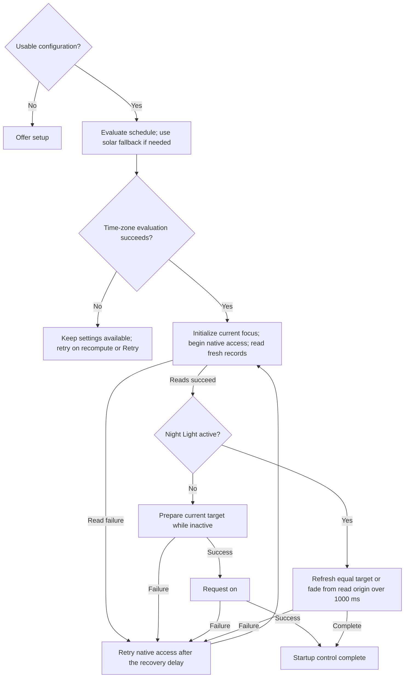

# Temperature control and lifecycle

Read [SPEC.md](SPEC.md), [schedule calculation](schedule.md), [suppression](suppression.md), and [native access](native-access.md) before this area.

## Startup and temperature changes

### REQ-startup-temperature — Apply the current temperature at startup

Startup evaluates the current accepted schedule, including enabled solar inputs, before beginning Night Light access. Solar failure uses the Wake/Bedtime-only fallback; a time-zone failure that prevents both curves follows REQ-schedule-evaluation-failure. Current focus does not defer calculation. Once startup prerequisites pass, automatic suppression is initialized from current focus without the focus delay.

The controller marks Night Light access begun immediately before attempting watcher registration and initial reads. The milestone remains true even if registration or reads fail. Both watchers are attempted before the initial reads; failed registration follows native recovery and does not prevent usable native control. The target follows current suppression and scheduling, not an inactive stored temperature.

Successful fresh reads select one branch:

- If Night Light is off, prepare the current target while inactive under REQ-temperature-refresh, then enable Night Light without a startup fade.
- If Night Light is active with a valid stored temperature, use that value as the origin of a separate 1000 ms fade toward the target at completion.
- If Night Light is active but its temperature field is absent or outside the supported range in an otherwise decodable record, use 6500 K as the fade origin.

A missing or undecodable record remains a read failure. An origin already equal to the intended target does not need a fade, but the startup attempt still completes a refresh. Output rounding follows REQ-temperature-refresh, even when the read origin is not a multiple of 10 K.

Startup treatment continues until a complete target application succeeds: required native schedule and activation operations have succeeded, and a direct target refresh or the current transition to the target has completed. A successful ordinary fade that replaced the startup fade also completes startup. An earlier schedule-off write or intermediate temperature write does not complete startup. If a retry is needed first, it selects its branch from fresh reads and current focus, rather than inventing a last written origin.

The separate startup duration applies even when ordinary fades are disabled. Its duration begins when the startup fade begins, not at process launch. A fade converges on the current curve under REQ-transition-fade. Initial suppression does not wait for focus delay; later focus changes use the configured delay.

An explicit Preview or benchmark request can replace startup's fade with that action's immediate entry rule. A successful full entry attempt completes native startup control. Inactive preparation remains mandatory before activation, and a failed entry does not complete startup.

**Note:** This diagram summarizes startup branches. Every failed operation uses the native recovery requirements.



**Scenarios:**

- Night Light is off with 2200 K stored and the current target is 3400 K: prepare 3400 K while inactive, then enable without an intermediate 6500 K value.
- Night Light is off at noon and preparing 6500 K fails: that attempt does not request on; a later retry repeats current-target preparation.
- Night Light is active at 2200 K and the target is 6500 K: startup uses a 1000 ms fade even with ordinary fades disabled or set to 10,000 ms.
- Night Light is active at the intended temperature: startup refreshes that value without an artificial one-second wait.
- A decodable active record has no temperature or has 7000 K: the fade origin is 6500 K.
- The initial reads fail before any temperature write. A retry reads active 3000 K: it uses that fresh origin for the 1000 ms startup fade.
- An intermediate startup step succeeds and the next fails: retry still uses startup rules until target application completes.
- Suppression replaces an unfinished startup fade with an ordinary fade to 6500 K. That fade and all required native operations succeed: startup is complete, and a later native failure uses ordinary recovery rather than restarting the 1000 ms startup fade.
- A listed game is focused with a 5000 ms focus delay: startup evaluates solar timing, then initializes suppression immediately.
- Time-zone acquisition fails before native access begins: settings remains available and Retry or a recompute event can retry prerequisites. Quit skips native cleanup.
- Recovery from that initial suspension uses current focus without the focus delay and then selects the startup branch from fresh native reads.

### REQ-transition-fade — Fade between temperatures

With ordinary fades enabled, effective suppression changes, accepted configuration changes, and recomputation after an interruption fade from the last written temperature toward the new target. A replacement fade starts from the last successfully stored step. Normal scheduled interpolation and accelerated playback do not start a separate fade at each update.

A fade returning to a curve converges on its temperature at the fade's completion instant, then continues the curve. If playback ends first, its exit rule cancels the unfinished fade. Suppression retains precedence throughout.

Settings provides one global fade enable switch and duration. Defaults are enabled and 500 ms; the inclusive duration range is 100–10,000 ms. Scheduled transition duration and the separate startup fade are independent. With ordinary fades disabled, target changes request one operation. Fade duration specifies a logical completion instant; native latency can delay the final request's completion, but does not extend the curve or queue missed steps.

Ordinary Preview and benchmark entry/exit use their immediate rules. Switching directly between them uses the incoming operation's entry rule without restoring accepted control between them. A configuration or clock change that ends playback first performs that exit rule; a subsequent accepted Save follows its separate ordinary configuration-change fade. Suppression activation cancels playback without an intermediate restoration write, then uses the suppression fade. Suspend and resume use REQ-suspend-resume, including cancellation when advance suspend notification was missed.

At completion the controller ensures the final current target has been stored; it does not repeat an already successful matching output solely to mark completion. A completed fade to the accepted schedule or fallback establishes its stored final value as the last scheduled temperature. Failed operations follow native recovery.

**Scenarios:**

- Suppression starts at night: temperatures progress toward 6500 K over the configured duration.
- Suppression ends halfway through a fade: the replacement begins at the last stored step.
- The schedule rises during a fade back: the fade reaches the curve's temperature at its completion time.
- Fades are disabled: a changed override requests one target operation, while scheduled transitions still progress over their configured duration.
- A configuration edit selects 100 or 10,000 ms: it is accepted. Values of 99 or 10,001 ms are invalid.
- An external writer changes temperature during a constant segment: reconciliation restores the intended value immediately without an ordinary fade.
- External configuration is accepted during Preview: playback ends and requests the new accepted current target immediately. It does not also start a competing fade for the same event.
- Save is requested during Preview: playback first ends using the prior accepted target; after successful persistence the configuration change uses an ordinary fade.
- Resume follows sleep during Preview: playback stays stopped and the ordinary recomputation fade applies.

### REQ-temperature-cadence — Request only due temperature changes

For schedule progression, fades, and Preview, the next output operation becomes due when the current calculated value, rounded to 10 K, differs from the intended temperature. The rate ceiling can defer issuance; observation retains the last issued value until then. Constant output does not cause recurring operations. The controller schedules the next necessary output time directly. It retains fractional calculation precision and does not repeatedly evaluate an unchanged interval at 50 ms or at the display rate.

Rapid output has a ceiling equal to the lower of synchronous complete-control-attempt throughput and the highest refresh rate among active displays. A complete attempt includes fresh native reads and the complete temperature refresh. All calls remain serialized, so actual call duration limits throughput without relying on a benchmark estimate. A benchmark is optional for operation and does not run automatically at startup.

The display ceiling uses the highest valid reported physical refresh rate among active displays, including a dynamic-refresh display's reported physical rate. Display information is acquired at startup, resume, and display-configuration changes, not for each output. If acquisition fails, retain the last valid ceiling; without one, use 30 Hz until acquisition succeeds. This fallback is an estimate when display information is unavailable.

While the output changes fast enough, request the latest quantized value at the earliest opportunity allowed by the display ceiling and completion of the preceding call. The same-value rule still applies. Do not extend a fade to visit every intermediate 10 K value. An executing operation completes before its successor; missed intermediate values are skipped. An operation finishing after the logical endpoint is followed only by the current final or replacement target, not a stale backlog.

Initialization, owned-value repair, explicit recovery, resume refresh, immediate playback entry/exit, and graceful exit are discrete actions rather than recurring animation. They remain serialized but do not wait for the animation display interval. A pending native read/write error replaces ordinary output deadlines with the recovery delay. The benchmark's repeated samples are the explicit same-value exception defined in its requirement.

**Scenarios:**

- A one-hour 6500 K to 2400 K transition starts at 6500 K: it has 410 distinct output changes, with interior 10 K thresholds about 8.78 seconds apart. Rounding determines the first and last threshold positions.
- Displays run at 60 and 144 Hz and each complete attempt takes 2 ms: rapid output is limited by 144 Hz, not 60 Hz or the native capacity of 500 attempts/second.
- The fastest display is 144 Hz but attempts take 10 ms: serialized output cannot exceed 100 attempts/second and does not queue work.
- A 500 ms fade spans 6500 K to 2400 K with a 60 Hz ceiling: it skips intermediate multiples of 10 K and retains its 500 ms logical endpoint.
- A native call takes 120 ms during a fast fade: after it returns, evaluation uses the current instant. No missed samples are replayed.
- Display acquisition initially fails: output uses a 30 Hz ceiling. A later display event reporting 144 Hz updates it.
- A slow transition would repeatedly round to 4000 K: it waits for the next rounding threshold rather than repeatedly refreshing 4000 K.

**Permitted choices:** Timer and scheduler mechanisms are internal. Deterministic tests verify exact due instants, serialization, and skipped steps. Runtime acceptance records operation latency separately; on the declared reference machine, 95% of starts are within 20 ms after the earliest eligible instant when the controller is otherwise healthy. A preceding synchronous call extends that eligible instant until completion. The final request follows the same bound.

## Scheduling failures and recovery

Scheduling has six states: waiting for usable configuration, available schedule, solar fallback, frozen temperature, suspended control, and exited. Native errors and suppression are independent. The diagram lists every state transition. Evaluation is required on a recompute event, settings Retry, or restoration after playback or suppression. Reusing an already calculated curve at a different instant does not require repeating a failed solar calculation.

```mermaid
stateDiagram-v2
  state "Waiting for usable configuration" as Waiting
  state "Evaluate current scheduling inputs" as Evaluate
  state "Available schedule" as Available
  state "Wake/Bedtime-only solar fallback" as Fallback
  state "Frozen last scheduled temperature" as Frozen
  state "Suspended control" as Suspended
  state "Exited" as Exited
  [*] --> Waiting
  Waiting --> Evaluate: Usable configuration loaded or saved
  Available --> Evaluate: Evaluation required
  Fallback --> Evaluate: Evaluation required
  Frozen --> Evaluate: Evaluation required
  Suspended --> Evaluate: Recompute event or Retry
  Evaluate --> Available: Required calculations succeed
  Evaluate --> Fallback: Solar fails; Wake/Bedtime-only evaluation succeeds
  Evaluate --> Frozen: Time-zone evaluation fails; last scheduled temperature exists
  Evaluate --> Suspended: Time-zone evaluation fails; no last scheduled temperature
  Waiting --> Exited: Quit or confirmed session end
  Available --> Exited: Quit or confirmed session end
  Fallback --> Exited: Quit or confirmed session end
  Frozen --> Exited: Quit or confirmed session end
  Suspended --> Exited: Quit or confirmed session end
  Evaluate --> Exited: Quit or confirmed session end
  Exited --> [*]
```

Returning to Frozen preserves its existing value. Native write failures do not erase the last scheduled temperature. Draft validation does not change accepted scheduling by itself.

### REQ-solar-calculation-failure — Continue with the Wake/Bedtime-only curve

If a required solar calculation fails for otherwise valid inputs, evaluate the same configuration with both solar targets omitted. This Wake/Bedtime-only fallback uses its configured temperatures, clocks, and transition duration. The failure does not freeze scheduling or change saved solar switches and coordinates. Settings shows the error and identifies fallback.

The same rule applies to startup, accepted scheduling, an unsaved draft, Save, external configuration reload, and Preview. A valid draft can be saved and previewed using fallback. An external candidate can be accepted with fallback. Invalid inputs are still rejected; fallback is not permission to accept invalid coordinates or clocks. If Windows time-zone evaluation also fails, REQ-schedule-evaluation-failure applies.

An accepted-schedule change to fallback cancels a fade based on unavailable solar targets and follows the triggering event's transition rule. Recomputations use an ordinary fade; ordinary playback exit restores immediately. During suppression, the override remains 6500 K while the underlying schedule changes. During Preview, a solar failure updates the playback curve to its fallback and playback continues to its original deadline.

Retry solar calculation on recompute events, settings Retry, or a new Save/Preview request; do not retry it at every temperature update or native recovery attempt. The next required date is recalculated even if the preceding date failed. Success or disabling both solar inputs clears that schedule's solar error. An error that recurs on the next date remains visible rather than expiring merely because a day passed.

**Scenarios:**

- Solar calculation fails at startup at 09:00 with Wake 07:00 and Daytime 6500 K: fallback supplies 6500 K under the normal startup rules.
- Daytime is 6500 K, Sleep is 2200 K, Bedtime is 01:00, and transitions last 60 minutes: fallback evaluates to 4350 K at 00:30 and keeps progressing despite repeated solar failures.
- The accepted solar curve stored 3400 K before a later solar failure: control switches to the current fallback, which can be brighter. It does not freeze at 3400 K.
- A listed game is focused at startup: solar calculation still runs. If it fails, fallback is ready while suppression requests 6500 K.
- Draft coordinates are valid but solar calculation fails: its fallback graph is displayed, Save and Preview remain usable, and accepted configuration changes only on Save.
- A valid external candidate has a solar failure: it is accepted with fallback and its error appears only inside settings.
- Solar failure occurs during Preview: the graph and intended output use fallback for the same playback instant, and its ten-second deadline is unchanged.
- A date change produces successful solar results after yesterday's failure: the error clears and current control recomputes without replaying yesterday's transitions.

### REQ-schedule-evaluation-failure — Freeze or suspend on time-zone failure

Failure to acquire the Windows time zone or to convert the required dates prevents evaluation of both the solar schedule and its Wake/Bedtime-only fallback. Settings reports this error. An accepted-schedule failure cancels its active fade, Preview, and benchmark.

If a last scheduled temperature exists, scheduling freezes at that value. A previously frozen value is preserved. Suppression can still override it, subject to native access, and ending the last suppression source returns to the frozen value. Suppression, playback, benchmark, and intermediate fade writes never establish or replace that baseline.

Without a last scheduled temperature, control is suspended until evaluation succeeds. Settings remains available. The controller does not activate suppression, start playback or a benchmark, or request temperature writes during suspension. An existing manual deadline continues to elapse and can be canceled or expire. If native access never began, Quit skips cleanup; otherwise its state-only off attempt remains applicable.

Recompute events and settings Retry retry evaluation, including during suppression. Ordinary native retry ticks do not repeatedly run a failing time-zone calculation. Successful evaluation clears that time-zone error and resumes at the actual current instant. Recovery with a stored schedule baseline uses ordinary recomputation fading. Recovery without a baseline uses startup preparation/fading and initializes automatic suppression immediately from current focus.

A time-zone failure confined to an unsaved draft preserves accepted control and the last valid graph, and prevents that draft's Save or Preview. It does not prove the accepted schedule failed. A failure during playback restores the accepted current target if that evaluation succeeds; otherwise its own freeze/suspension result applies.

**Scenarios:**

- The accepted schedule stored 3400 K before a time-zone failure: scheduling freezes at 3400 K. A listed app can suppress to 6500 K and return to the frozen value.
- Fallback stored 4350 K before time-zone conversion fails: the frozen value is 4350 K.
- Preview last wrote 5000 K but the accepted schedule last stored 3400 K: a time-zone failure freezes at 3400 K.
- Suppression has stored only 6500 K since startup, and time-zone evaluation fails: there is no schedule baseline, so control suspends.
- A listed game is focused during initial time-zone failure: its override does not bypass prerequisites. Settings Retry can repeat evaluation immediately.
- Evaluation later succeeds with that game focused: recovery without a baseline initializes suppression immediately, even with a 5000 ms focus delay.
- A manual hour expires during suspension: recovery does not reactivate it.
- A draft alone fails conversion while accepted evaluation succeeds: normal control continues and the draft's error appears in settings.
- A skipped clock occurrence is successfully resolved by the elapsed-interval rule: it is not a conversion failure.

### REQ-target-recompute — Recompute from current inputs

The controller refreshes scheduling inputs and foreground state after:

- Startup loads or saves usable configuration.
- The system resumes or the user session unlocks.
- The system clock, time zone, or automatic daylight-saving adjustment setting changes.
- A configuration change is accepted.
- A date needed for the current curve or solar calculation changes.
- The user selects settings Retry.

Recompute the accepted schedule even under suppression. The override prevents underlying temperature output, not input calculation. Outside suppression or playback, recomputation uses the current instant and the ordinary fade. Playback cancellation rules take precedence when the event also ends playback. Resume follows REQ-suspend-resume, including its required complete refresh.

Selecting a different Windows time zone recomputes all surrounding manual occurrences under that zone's rules. The difference between the old and new zone's current UTC offsets is not itself a daylight-saving transition for elapsed-interval adjustment. An actual seasonal transition within the newly selected zone's rules still follows the schedule's clock-change policy.

**Scenarios:**

- Sleep spans a scheduled transition: resume evaluates the current target, not missed intermediate values.
- A listed game remains focused across resume: suppression remains active while the current underlying schedule is recalculated.
- A clock or zone change occurs during suppression: inputs are recalculated then; ending suppression uses the current curve.
- Eastern time switches automatic daylight-saving adjustment off in July: evaluation uses standard time without changing saved clocks.
- New York changes to London on an ordinary date: Wake remains the configured London clock rather than gaining the difference between the zones' UTC offsets.

## Suspend and resume

### REQ-suspend-resume — Restore current control after suspend and resume

When the existing Circadia process resumes execution after sleep, hibernation, hybrid sleep, or Modern Standby, it reevaluates current control and requires a complete native temperature refresh. This applies with settings closed and without waiting for session unlock. It does not depend on receiving or completing an advance suspend notification. A new process follows startup rules, including after shutdown or Fast Startup.

On suspend notification, cancel active fades, Preview, benchmark samples, and pending output work. Resume cancels any of that work still pending even if suspend notification was missed. Playback and benchmark do not restart automatically. Suspend cancellation does not request an immediate playback-restoration write; resume selects the current accepted target. Suspending does not initiate exit cleanup or clear manual suppression. Circadia does not prevent suspension or wake the computer solely to advance its curve.

Before starting new native output after resume, the controller:

1. Discards obsolete output steps and timer callbacks. An already executing synchronous native operation completes before another begins; its completion does not authorize the remaining obsolete steps.
2. Refreshes current time and Windows time-zone inputs, then evaluates the accepted schedule for the dates needed at that instant. Required solar events use those dates and saved coordinates. Schedule failures follow the existing fallback, freeze, or suspended-control rules.
3. Checks manual suppression expiry under REQ-manual-suppression and reevaluates current foreground identity under REQ-suppress-on-focus. Discard any pending focus delay. Once automatic suppression has been initialized, current focus starts a fresh full delay only if it requests a change to that state. Startup and recovery from time-zone suspension without a baseline retain immediate focus initialization.
4. Refreshes the display rate ceiling and starts one current-state native attempt under the existing access guards. It reads settings and state afresh before writes, even when cached owned values already match.

The curve advances through the entire suspended interval. Resume does not replay missed temperatures, focus changes, or retries, and does not extend a scheduled transition. For established control, a changed target uses the ordinary fade from the last written temperature toward the curve at fade completion. A resume during incomplete startup retains startup rules. Fresh reads that find Night Light off use inactive preparation before activation.

Resume requires a complete temperature refresh even when the intended and stored temperatures match. A complete refresh in the resumed fade, inactive preparation, or recovery satisfies this obligation; it does not require an additional identical operation. If the target is unchanged and no fade is needed, request one complete refresh directly. The ordinary cadence then applies. Repeated notifications for the same resume do not repeat this obligation or restart a fade solely because another notification arrived. Changed inputs still follow their own recomputation rules.

**Failure behavior:** Until startup prerequisites have first passed, or while control is suspended, temperature writes remain prohibited. The refresh remains required until control becomes available or the process exits. Resume replaces a pending native retry deadline with its one current-state attempt; failure continues the shared recovery sequence. Failed reads prevent writes, and a failed refresh remains pending until a complete refresh succeeds. Repeated notifications do not bypass the resulting recovery delay.

**Scenarios:**

- Solar timing is disabled, Sleep is 2200 K, Daytime is 6500 K, Bedtime is 23:00, Wake is 07:00, and transitions last 60 minutes on an ordinary date. The computer sleeps before 06:00 and resumes at 06:30: the curve evaluates to 4350 K. With ordinary fades enabled, output converges on the advancing curve at fade completion; it does not restart the hour-long transition.
- The same configuration resumes at 09:00: the target is 6500 K, without replaying the morning's intermediate temperatures.
- Hibernation spans several calendar dates with solar timing enabled: evaluation calculates the dates surrounding the resumed instant rather than reusing the last awake date's solar events.
- Sleep spans a one-hour forward clock change with Bedtime 23:00 and Wake 07:00: the existing elapsed-interval rule resolves Wake to 08:00. Resume at 07:30 evaluates the adjusted transition, independently of whether Circadia ran during the clock change.
- The same configuration sleeps across a one-hour backward clock change: Wake resolves to 06:00. Resume at 05:30 evaluates to 4350 K during the adjusted transition.
- The one-hour manual override starts at 22:00, sleep begins at 22:20, and resume occurs at 23:10: the first resumed target excludes the expired manual source. Automatic suppression can still request 6500 K independently.
- A matching app remains focused and automatic suppression was active: resume retains suppression, recalculates the underlying schedule, and completes a 6500 K refresh.
- A matching app had completed 200 ms of a 250 ms delay before sleep, with automatic suppression still off. It is still focused at resume: activation requires a fresh 250 ms delay. If current focus is nonmatching instead, the pending activation is canceled.
- The curve and stored temperature both remain 3400 K across sleep: resume still requests one complete refresh. A later matching observation does not repeat it.
- Automatic and user-resume notifications describe one wake during an ordinary fade: the later notification does not restart that fade or force another refresh. A subsequent actual foreground change still follows its suppression rules.
- Preview or benchmark was active when the process stopped without advance suspend notice: resume cancels it before new output, retains the unsaved draft, and restores accepted control under the resume transition rules.
- Resume occurs with a native retry pending: one current-state attempt replaces the old deadline. If its read fails, that attempt does not write; automatic recovery continues without replaying elapsed retries.
- Resume finds a time-zone failure and no last scheduled temperature: control remains suspended. After evaluation recovers, startup rules and the pending complete refresh apply.
- Resume finds a time-zone failure after the accepted schedule stored 3400 K: scheduling freezes at 3400 K and the required refresh still runs, subject to native access. Active suppression instead refreshes 6500 K without replacing the frozen baseline.
- A partial native operation spans suspension: it finishes before resume's new attempt, which uses fresh records and the current target. Queued obsolete fade steps do not execute afterward.
- A restored process runs after Modern Standby while settings remains closed and the session stays locked: it performs resume reconciliation when Windows permits execution and delivers the resume event.
- A new process starts after Fast Startup: runtime-only suppression and fades start under the startup requirements.

## Exit

### REQ-exit-night-light-off — Turn Night Light off on graceful exit

Once Night Light access has begun, Quit and confirmed Windows session end initiate one best-effort off attempt, even if prior control failed or scheduling is suspended. Confirmed session end includes sign-out, shutdown, restart, and closure for servicing. Closing settings keeps control running. System suspension and session lock do not initiate exit cleanup.

Exit discards unsaved settings without saving or prompting. It cancels focus delays, manual suppression, fades, playback, benchmark samples, and native recovery. New control operations stop. An executing synchronous library operation must finish before cleanup starts; cancellation does not abandon it and begin an overlapping call.

Cleanup uses the public off operation's fresh state read and requests off if necessary. It does not require a settings read, write a final temperature, restore the native schedule, or fade. A pending error does not skip this attempt. A state-read or off-write failure is recorded in diagnostics and exit continues without retry, confirmation, or an added grace period. If startup prerequisites never passed and native access did not begin, exit skips cleanup.

Windows' initial session-end query returns without waiting for native work, cleanup, or user input. Cleanup starts only on confirmed session end and runs before the handler returns, subject to Windows allowing execution to finish. Canceling session end leaves control running. A crash, forced termination, power loss, or process termination during cleanup can leave the prior state.

The public off operation does not clear a native preview flag left on by an earlier failed refresh. Exit still makes the same state-only off attempt. Successful off storage does not guarantee untinted output in that case.

**Scenarios:**

- Night Light is active at 2200 K: Quit requests off without a fade or final temperature write.
- Settings has unsaved edits when Quit is selected: the draft is discarded without a prompt; the prior saved configuration remains.
- A synchronous operation is executing: it completes before off cleanup, and queued control work does not execute afterward.
- Settings is unreadable but state is readable: exit can still request off.
- The cleanup state read fails: the failure is recorded and exit continues without a write. An off-write failure likewise does not trigger a retry.
- Night Light is already off: cleanup succeeds without another state write.
- Prior native-preview cleanup failed: exit requests off but does not claim to clear native preview or verify neutral output.
- Startup access began but every normal read failed: exit still attempts the public state-only off operation.
- Windows queries session end and then cancels it: Circadia has not started cleanup and continues control.
- First-run setup was never saved: Quit does not access Night Light.
