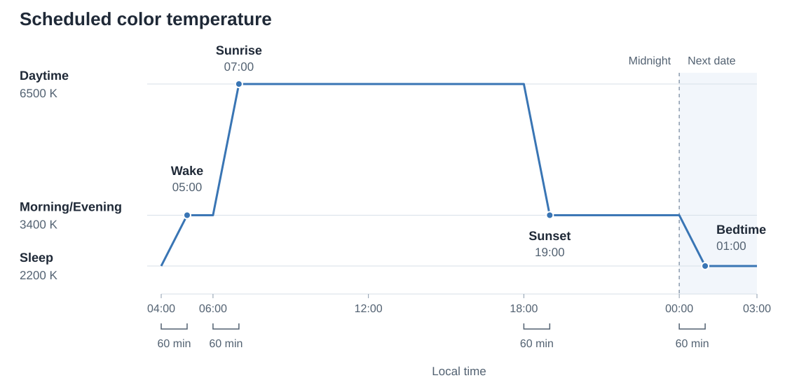

# Daily temperatures, Wake, Bedtime, and solar timing

Read the shared terms and invariants in [SPEC.md](SPEC.md) before this area. This area defines schedule inputs and calculation results. A daily activity interval runs from Wake through the following Bedtime. An adjusted occurrence is a dated Wake or Bedtime after the clock-change rules have been applied.

## Schedule settings

### REQ-configure-time-anchors — Configure Wake and Bedtime clocks

The user specifies Wake and Bedtime as distinct local clock times in whole minutes from 00:00 through 23:59. They repeat daily in the computer's Windows time zone, honoring its actual automatic daylight-saving adjustment setting. Circadia does not derive either saved clock from the other or from location. Bedtime can be after midnight.

For Wake 07:00 and Bedtime 01:00, Bedtime belongs to the next calendar date. Changing either clock regenerates the curve. Circadia does not move either clock to resolve a solar conflict. The clock-change rules below adjust dated occurrences without changing saved clocks. Invalid input preserves the last valid graph and disables Save and Preview.

**Scenarios:**

- Wake is 07:00 and Bedtime is 01:00: the activity interval includes the evening and ends the following day.
- Bedtime changes from 23:00 to 22:30: the Sleep target moves to 22:30 and the preceding transition is regenerated.
- Both clocks are 07:00: the draft identifies the equal clocks and cannot be saved.
- Both clocks and temperature settings are valid, with solar timing disabled: the schedule works without location access.
- Windows uses Eastern time with automatic daylight-saving adjustment disabled in July: Wake 07:00 occurs at 12:00 UTC. With adjustment enabled, it occurs at 11:00 UTC on an ordinary July date.

### REQ-configure-period-temperatures — Configure three ordered temperatures

Settings exposes Daytime, Morning/Evening, and Sleep temperatures. Morning and evening use the same middle temperature. Accepted values satisfy Daytime >= Morning/Evening >= Sleep. Equal values are allowed. An edit that violates this order shows an error and disables Save and Preview; it does not change another temperature to accommodate the edit.

Each temperature is a whole number from 1200 K through 6500 K. Accepted input rounds to the nearest 10 K, with ties toward higher kelvin. Range validation occurs before rounding; order validation uses the rounded values. Fractional kelvin input is rejected. Numeric fields show the accepted values.

Users configure these temperatures and timing settings. They do not add, remove, or drag individual curve points, supply offsets, or draw transition curves.

When both solar inputs are off, Morning/Evening remains editable and is labeled unused by the Wake/Bedtime-only curve. It still participates in temperature-order validation. Circadia does not silently clamp another temperature to resolve an invalid order.

**Scenarios:**

- Daytime 6500 K, Morning/Evening 3400 K, and Sleep 2200 K are valid.
- Morning/Evening and Sleep are both 2200 K: that evening-to-sleep interval is constant.
- Sleep is changed to 4000 K while Morning/Evening is 3400 K: Save is disabled and the other fields retain their values.
- The user enters 3855 K: it becomes 3860 K if the resulting order is valid. Entering 6501 K or fractional kelvin is rejected.
- Both solar inputs are off: Morning/Evening remains editable but does not affect the curve. Wake reaches Daytime directly.
- Both solar inputs are off and Sleep changes to 3600 K while Morning/Evening is 3400 K: settings identifies the ordering error and the user can directly raise the middle value before saving.

### REQ-configure-scheduled-transition — Configure the scheduled transition duration

Settings provides one shared duration for scheduled temperature transitions, initially 60 minutes, within the inclusive range 1–240 whole minutes. It specifies the maximum duration before each target. REQ-evaluate-daily-curve shortens it when consecutive targets are closer together.

This duration is separate from the ordinary fade for suppression changes, recomputation, and recovery from native errors. Scheduled transitions remain linear over their generated intervals.

**Scenarios:**

- The duration is 60 minutes and targets are several hours apart: each change takes place during the hour before its target.
- The duration is 60 minutes and targets are 30 minutes apart: the later transition uses 30 minutes.
- Durations of 1 and 240 minutes are accepted. Zero, a negative value, 241 minutes, or fractional minutes disables Save and Preview and shows an error.

## Optional solar timing

### REQ-configure-solar-location — Select coordinates explicitly

Solar timing requires valid latitude and longitude. Settings offers a current-location action and manual coordinate entry. The current-location action requests Windows location access while settings is in the foreground, obtains a single position, and places it in the draft. Circadia does not request location merely because it starts or settings opens. Valid coordinates become active in the live draft immediately; Save persists them.

Latitude must be finite and within -90 through +90 degrees; longitude must be finite and within -180 through +180 degrees. The active configuration's coordinates remain in use until the user changes them. Circadia does not track travel automatically, infer the computer's time zone from coordinates, or offer city/address search in the MVP.

If permission is denied, location services are disabled, or a position cannot be obtained, settings reports the failure and preserves the existing coordinates. Manual entry remains available. An unfinished request does not prevent the active schedule from running. Closing settings cancels the request or discards its eventual result without changing the draft or saved configuration.

**Scenarios:**

- The user enables solar timing and manually enters 40.7128, -74.0060: saving does not require Windows location permission.
- The user requests the current location and grants access: the detected coordinates appear in the draft; they become active when the resulting draft is valid, and Save persists them.
- Windows denies access: the saved coordinates and accepted schedule remain unchanged, and manual entry is available.
- A position arrives after settings closes: it does not overwrite saved coordinates or change the accepted schedule.
- Latitude 91, longitude -181, or a nonfinite value is entered: the draft cannot be saved with solar timing enabled.
- The computer travels while saved coordinates remain unchanged: solar timing still uses those coordinates and the current Windows time zone.

### REQ-compute-solar-events — Calculate optional Sunrise and Sunset targets locally

The user can independently enable Sunrise and Sunset as optional timing inputs. Solar timing is enabled when either or both switches are on. An enabled input uses solar events calculated locally from the active configuration's coordinates for the dates needed by evaluation, the graph, or Preview. Circadia does not persist solar results, precompute a rolling date window, or maintain caches for previously visited locations. It does not use the native Windows Night Light schedule or an online daily solar service. Sunrise and Sunset use the Sun's center crossing exactly −50 arcminutes (about −0.833°) of geometric elevation at sea level, the conventional horizon with a fixed allowance for solar radius and refraction. It does not adjust for observer elevation, weather, or terrain obstruction, or estimate room brightness.

Solar results are actual instants interpreted in the computer's Windows time zone. Calculation and selection retain their precision; this requirement does not require displaying numeric solar timestamps. The calculation supports zero or multiple events of either kind and does not assume a maximum of two.

Only solar events within adjusted Wake through the following adjusted Bedtime are candidates for that activity interval, including any clock-change adjustment to those Wake and Bedtime occurrences. Sunrise candidates include the starting boundary and exclude the ending boundary. Sunset candidates lie strictly between the boundaries. These exclusions occur before candidate selection.

At most one Sunrise and one Sunset are retained. Selection uses actual instants in chronological order:

- If both enabled inputs have candidates, the curve uses the earliest Sunrise and the earliest Sunset strictly after it.
- If both have candidates but no Sunrise precedes any Sunset, the curve omits both solar targets for that interval. Settings explains the timing conflict; the Wake/Bedtime-only curve remains valid.
- If only one enabled input has candidates, the curve uses its earliest candidate.

Extra events cannot create another sleep/wake cycle. A Sunrise coincident with Wake produces the single Daytime target defined by REQ-evaluate-daily-curve and prevents selection of a later Sunrise for that interval. An ordering conflict is a successful calculation with unusable timing, not a calculation failure.

Settings reports a timing conflict for each affected activity interval that the settings graph currently displays. During Preview this means the displayed playback view. It does not claim to validate every future date. A conflict remains a valid schedule with the conflicting solar targets omitted.

A disabled or naturally absent solar event is omitted before generating transitions. Circadia does not substitute a fixed clock, move a manual clock to accommodate solar timing, or reuse another date's event. An empty successful result and a calculation failure are distinct outcomes; callers receive the error instead of treating it as an empty result.

**Scenarios:**

- The network is unavailable after coordinates have been saved: ordinary daily solar calculation continues locally.
- A polar date has no sunrise or sunset: both solar targets are omitted, leaving the Wake and Bedtime schedule.
- Sunset exists but Sunrise is absent: Wake reaches Daytime, and the Sunset target applies when it lies within the activity interval.
- Sunset occurs at 00:13 and 23:59 on one date. With Wake 07:00 and Bedtime 01:00, the later sunset belongs to that activity interval; the earlier one does not.
- A result has multiple sunsets: the app does not create multiple evening-to-daytime cycles.
- A synthetic candidate list has Sunrises at 08:00 and 12:00 and Sunsets at 10:00 and 18:00, all inside the activity interval: selection retains 08:00 and 10:00, regardless of input order.
- Both inputs are enabled, with Sunset at 07:13 and Sunrise at 08:29 inside Wake 07:00 through Bedtime 01:00, and no later Sunset: both solar targets are omitted, settings explains the conflict, and the Wake/Bedtime-only curve continues without a solar error.
- Sunrise is disabled and Sunset candidates are 18:00 and 23:59 inside the activity interval: only 18:00 is retained.
- A synthetic result has Sunrises at Wake and two hours later: Wake reaches Daytime and the later Sunrise is ignored.
- Sunset coincides with Wake and another Sunset occurs before Bedtime: the first is excluded before selection, so the later Sunset remains eligible.
- Coordinates correspond to a different time zone from Windows: results use the Windows clock without changing the saved Wake and Bedtime clocks.

## Generated temperature curve

### REQ-evaluate-daily-curve — Reach each schedule target by its time

Bedtime reaches Sleep. When a retained Sunrise follows Wake, Wake reaches Morning/Evening and Sunrise reaches Daytime. When Sunrise is disabled, absent, or at or before Wake, Wake reaches Daytime directly. A retained Sunset before Bedtime reaches Morning/Evening. Sunset at or after Bedtime is omitted completely before generating the curve. Sunrise coincident with Wake produces one Daytime target; Sunset coincident with Bedtime produces one Sleep target.

The daily order is Wake, optional Sunrise, optional Sunset, and Bedtime. Solar eligibility and selection use the adjusted Wake and Bedtime occurrences before any merging. When a solar target is omitted, the curve connects the remaining consecutive targets directly.

Before generating transitions, merge targets less than 60 elapsed seconds apart in chronological order. Compare each next target with the last retained target's time. A merge keeps that earlier time and adopts the later target's temperature. The retained time does not advance after a merge, so a chain of individually close original points does not automatically collapse into one target. Exactly 60 seconds remains separate.

Merging applies to all selected targets, including equal-temperature targets, across midnight and the settings graph's display boundaries. It does not change saved Wake or Bedtime clocks or rerun solar eligibility against shifted targets. It can reach the later temperature before its original occurrence. Remaining equal-temperature targets retain their timing role; removing one could incorrectly lengthen the next transition. The one-minute minimum applies to the real-time schedule, not to its compressed Preview playback.

Between consecutive schedule targets, the schedule stays at the earlier temperature until the later target's transition must begin. The transition uses the shorter of the configured duration and the elapsed interval between those targets. It interpolates linearly from the earlier temperature to the later one, reaching the later temperature exactly at its target instant. Equal temperatures produce a constant segment. These rules also apply from Bedtime through the next Wake, across midnight and calendar dates.

Interpolation uses elapsed real time and retains fractional kelvin. There is no daily reset, easing, temperature band, or hysteresis. Output rounding does not change curve calculation.

Wake and Bedtime occurrences use the selected Windows time zone and its actual daylight-saving adjustment setting. Their nominal interval is the clock-face difference between consecutive dated Wake and Bedtime clocks, before applying UTC offsets; adjustment applies it as elapsed time. Unchanged inputs produce the same dated occurrences regardless of process start time or evaluation order, including a start after the seasonal offset change. Each occurrence follows these rules relative to the preceding adjusted occurrence:

1. The configured clock's candidate uses the selected zone's rules. A repeated clock initially selects its first occurrence.
2. If the configured clock is nonexistent, or that candidate is at or before the preceding adjusted occurrence, the occurrence is one nominal elapsed interval after its predecessor.
3. If a seasonal offset transition occurs after the preceding adjusted occurrence and at or before the candidate, the occurrence is also one nominal elapsed interval after its predecessor. This preserves the interval even when the configured clock is later than the changed hour.
4. Otherwise, the occurrence uses its configured clock's candidate. Adjustment propagates only while the preceding conditions require it.

The adjustment uses the actual offset difference, including changes other than one hour. An adjusted instant can fall in the second occurrence of a repeated interval. Saved clocks remain unchanged, and the return to configured clocks can shorten or lengthen the following interval. Circadia does not shift clocks gradually before daylight saving. Selecting a different Windows time zone regenerates all these occurrences under the new zone; the old-to-new current offset difference is not a seasonal transition.

Solar events remain their actual instants. Clock changes do not move them or remove them merely because a displayed clock repeats. Solar selection uses the adjusted Wake and Bedtime boundaries; no omitted or invented Wake or Bedtime boundary is substituted for them.

**Example:** This curve uses Daytime 6500 K, Morning/Evening 3400 K, Sleep 2200 K, and 60-minute transitions on a day without a clock change. The schedule targets occur at Wake 05:00, Sunrise 07:00, Sunset 19:00, and Bedtime 01:00 the following date. The illustration shows the schedule from 04:00 through the following 03:00; its labels do not prescribe the settings graph's appearance.

**Example:** The rising transitions run from 04:00 to Wake and from 06:00 to Sunrise. The falling transitions run from 18:00 to Sunset and from midnight to Bedtime. Each reaches its target at the target time; the curve continues through midnight without resetting.

**Scenarios:**

- Daytime is 6500 K, Morning/Evening is 3400 K, Sleep is 2200 K, Sunset is 18:13, and Bedtime is 01:00. With 60-minute transitions, 17:13–18:13 reaches 3400 K; 00:00–01:00 reaches 2200 K. Between those transitions the temperature remains 3400 K.
- Sunset is 20:00 and Bedtime is 19:30: Sunset is omitted. With Daytime 6500 K and a 60-minute duration, the schedule transitions directly from 6500 K at 18:30 to Sleep 2200 K at 19:30.
- Sunset is 19:00 and Bedtime is 19:30: the schedule reaches Morning/Evening 3400 K by 19:00, then Sleep 2200 K by 19:30. The second transition is shortened to 30 minutes.
- Wake is 05:00 and Sunrise is 07:00: with Sleep 2200 K and a 60-minute duration, 04:00–05:00 reaches Morning/Evening 3400 K, and 06:00–07:00 reaches Daytime 6500 K.
- Sunrise is before Wake or is omitted: Wake reaches Daytime directly from the previous schedule target's state, using the same duration and shortening rules.
- Sunrise and Wake coincide at 07:00: Daytime is reached by 07:00 without a separate middle-temperature target at that instant.
- Sunset and Bedtime coincide at 19:30: Sleep is reached by 19:30 without a separate evening target at that instant.
- Sunrise coincides with Bedtime: Sunrise is excluded and Bedtime reaches Sleep without a Daytime target at that instant.
- Wake is 07:00 and selected Sunrise is 07:00:30: they merge into a Daytime target at 07:00; the saved Wake clock is unchanged.
- Sunset is 22:59:30 at 3400 K and Bedtime is 23:00 at 2200 K: the merged target reaches 2200 K at 22:59:30. Bedtime remains saved as 23:00.
- Targets occur at 07:00, 07:00:40, and 07:01:20: the first two merge at 07:00, and the third remains 80 seconds later. Originally adjacent gaps do not merge the whole chain.
- Two targets are exactly 60 seconds apart: both remain. A 59-second gap merges to the earlier time and later temperature.
- Sunset is 23:59:40 and Bedtime is 00:00: merging reaches Sleep at 23:59:40 without resetting at midnight.
- Sleep and Morning/Evening are both 2400 K, Wake is 07:00, Sunrise is 07:30 at 6500 K, and duration is one hour: the equal-temperature Wake remains a schedule target, so warming starts at 07:00 rather than 06:30.
- Targets of the real-time schedule have been merged to meet the minimum spacing: compressing the curve for Preview does not merge its targets again.
- A one-hour transition goes from 4000 K to 4010 K: at 15 minutes it evaluates to 4002.5 K. The intended temperature remains 4000 K. At 30 minutes, the 4005 K midpoint rounds to 4010 K for native output and readback comparison.
- Bedtime is 01:00, Wake is 07:00, and solar timing is disabled: Sleep remains in effect until the next Wake transition begins; midnight does not reset the curve.
- Windows advances from 02:00 to 03:00. Previous Bedtime is 23:00 and Wake is 07:00: Wake occurs at 08:00, eight elapsed hours after Bedtime. That evening's Bedtime returns to 23:00; the saved clocks remain 07:00 and 23:00.
- Windows moves backward from 02:00 to 01:00. Previous Bedtime is 23:00 and Wake is 07:00: Wake occurs at 06:00, eight elapsed hours after Bedtime. That evening's Bedtime returns to 23:00.
- Windows advances from 02:00 to 03:00. Previous Wake is 07:00 and Bedtime is 03:30: Bedtime occurs at 04:30, 20.5 elapsed hours after Wake. The following Wake returns to 07:00, so that night lasts 2.5 elapsed hours instead of 3.5.
- Windows advances from 02:00 to 03:00. Previous Bedtime is 23:00 and Wake is 02:30: Wake occurs at 03:30, after three and a half elapsed hours. A Sunrise at 03:10 is outside the adjusted activity interval; a Sunrise at 03:40 remains eligible.
- Windows moves backward from 02:00 to 01:00. Bedtime is 00:30 and Wake is 02:30: Wake occurs at the second 01:30, two elapsed hours after Bedtime. A Sunrise instant between that Wake and the following adjusted Bedtime remains eligible even if its displayed clock repeats.
- Windows advances from 02:00 to 03:00. Bedtime is 02:45 and Wake is 03:15: the affected Bedtime occurs at 03:45. Returning Wake to 03:15 would reverse their order, so Wake occurs at 04:15, preserving the nominal 30-minute interval. The following Bedtime returns to 02:45.
- Windows advances from 02:00 to 03:00. Bedtime is 02:15 and Wake is 02:45: Bedtime occurs at 03:15. The configured Wake is also nonexistent, so Wake occurs at 03:45, 30 elapsed minutes later. The following Bedtime returns to 02:15.
- Windows moves forward by 30 minutes from 02:00 to 02:30. Previous Bedtime is 23:00 and Wake is 02:15: Wake occurs at 02:45 after three hours and 15 elapsed minutes. The adjustment is 30 minutes, not one hour.
- Bedtime is 01:30 before a backward change from 02:00 to 01:00, and the preceding Wake was unaffected: Bedtime uses the first 01:30. The following Wake preserves its nominal elapsed interval across the change.
- Automatic daylight-saving adjustment is disabled and the effective Windows rules have no transition that night: Wake and Bedtime use their configured clocks without a seasonal shift.
- The computer changes from New York time to London time: configured clocks follow London local time, and solar results are regenerated using the saved coordinates. A five-hour difference between the zones does not itself add five hours to Wake.
- The app restarts or evaluates the same dates in reverse order: unchanged inputs produce the same curve.
